# OtoWake BG User Guide — Mac

This guide shows how to use the features in the Mac edition of OtoWake BG. Before you start, read "Things to know before you use it" in the [Release Notes](release-notes.md).

Names of buttons and screens appear in quotation marks. If a name looks different on your screen, your version of the app may differ. Window titles end in "OtoWake BG", as in "Home — OtoWake BG" and "Player — OtoWake BG".

## 1. Install and first launch

### What you need

- A Mac with Apple silicon, running macOS 14.2 or later (it does not run on Intel Macs)
- Audio you are allowed to use: an audio file, or sound playing on the Mac

OtoWake BG is free.

### Install

OtoWake BG comes as an installer file (`OtoWakeBG-<version>-mac.pkg`). The installer speaks English or Japanese, following the language of your Mac.

1. Double-click the `.pkg` file you downloaded.
2. Follow the steps with "Continue", then press "Install".
   - Under "Destination", "Install for me only" puts the app in the Applications folder of your home folder (`~/Applications`), without an administrator password.
   - "Install for all users of this computer" puts it in the Applications folder and asks for an administrator password.
3. When it is done, press "Close" and open OtoWake BG from the Applications folder.

The installer is not signed by its developer, so macOS may say it could not open it. If so, open "Privacy & Security" in System Settings and press "Open Anyway" next to the OtoWake BG installer near the bottom.

Opening the installer of a newer version replaces the OtoWake BG you have. Your settings and data are kept.

### Uninstall

Quit OtoWake BG, then move OtoWake BG from the Applications folder to the Trash. To remove your settings and data too, move `~/Library/Application Support/OtoWake BG/` to the Trash as well.

### First launch

The app opens on Home. An icon also appears in the menu bar.

- "Playback history" on the left lists the songs you have played. "New jam" opens the player.
- "Practice songs" on the right lets you register a song with its instrument, key and speed.
- The buttons at the top right are "Tablature", "Manage history" and "Settings".

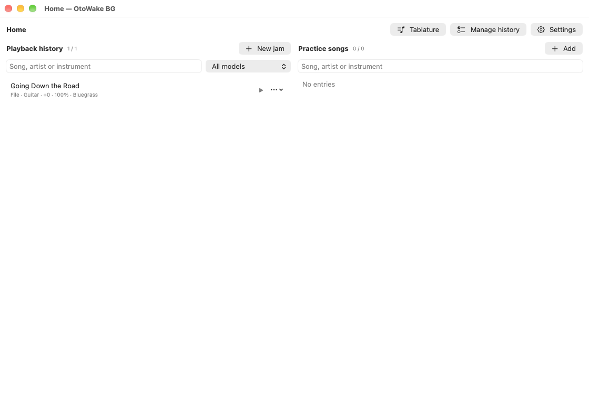

If you lose the window, bring it back with any of these:

- The menu bar icon
- ⌃⌥⇧O (opens or closes the control panel as a window)
- The Dock icon (once "Show icon in the Dock" is on under "Display" in Advanced Settings)

Settings, history, tabs and recordings are kept in `~/Library/Application Support/OtoWake BG/`.

### Permission to capture Mac audio

macOS asks for permission only when you capture sound playing on the Mac. Opening an audio file does not need it.

1. On Home, choose "New jam" under "Playback history" to open the player.
2. On the "Playback" tab, set "Source" to "Mac Audio".
3. In the "Getting Started" box near the top of the player, press "Allow". If macOS asks, allow it.

The "Getting Started" box lists three steps: "Allow", "Play a song" and "Enable separation". The "Allow" row appears only while "Source" is "Mac Audio", not when it is "File".

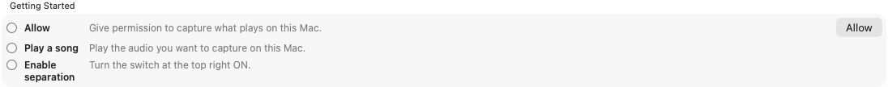

If permission is missing, the app says "System audio recording is not allowed." Press "Open Settings", then in System Settings > Privacy & Security > Screen & System Audio Recording, switch OtoWake BG on.

The captured sound is not saved.

## 2. Getting sound in

### The basics

Switch "Enable separation" on at the top right of the player (⌃⌥⇧K does the same). Sound starts after a delay (see "About the delay" below).

The player has three tabs: "Playback", "Record" and "Groove Check (experimental)". Beside the song title, a badge shows the method and the delay, for example "Real time (about 16 s behind)".

### Use an audio file

1. On the "Playback" tab, set "Source" to "File".
2. Press "Open…" and choose an audio file without DRM (copy protection). It plays from the start.
3. Switch "Enable separation" on.

You can also open a file with Open With in the Finder, or drop it on the app icon.

Files you played before are on Home under "Playback history". Removing a file from the history does not delete the file itself.

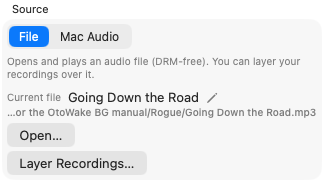

### Use sound playing on the Mac

1. Set "Source" to "Mac Audio".
2. Choose what to capture:
   - "All Mac audio" takes everything the Mac is playing, notification sounds included.
   - "A specific app" takes the sound of one app only. Choose the app, then play a song in it. If it is not in the list, press "Refresh Lists".
3. Play a song and switch "Enable separation" on.

You do not need to change the Mac's sound output. The captured app's own sound is muted at the point of capture, and only the processed sound plays.

With "Mac Audio" you can go back up to 2 minutes. Press "Back to Live" to return to the sound now playing.

### Choose where it plays

Open the "Output" box (click its heading) and choose where the sound plays. With "System Default", the sound moves to your headphones when you plug them in.

### About the delay

Because the app captures and splits the sound, you hear it later than the original. The badge beside the song title ("Real time (about 16 s behind)", for example) shows the delay at that moment. With video, the sound lags behind the picture.

When you open a file, the app separates the song twice and averages the results (Advanced Settings > "Separation" > "Separate files twice and average"), so the delay is about 15 seconds. If you switch that setting off, it drops by 6 to 7 seconds (to about 8). The trade-off is that how the instruments are divided can wobble with where the song is cut into chunks.

## 3. Change the volume of each part

In the "Volume" box on the "Playback" tab:

1. "Separation mode" is "Bluegrass".
2. "Part controls" lists the parts: vocals, banjo, mandolin, fiddle, dobro, guitar and bass. The rest (drums, piano and other) is not listed.
3. Untick a part to silence it. Move the slider to change its level.
4. "All On" and "All Off" switch everything at once.

**When you open a new song, "Vocals" starts at 0%.** If the singing is quiet or missing, nothing is broken: raise the "Vocals" slider to hear it.

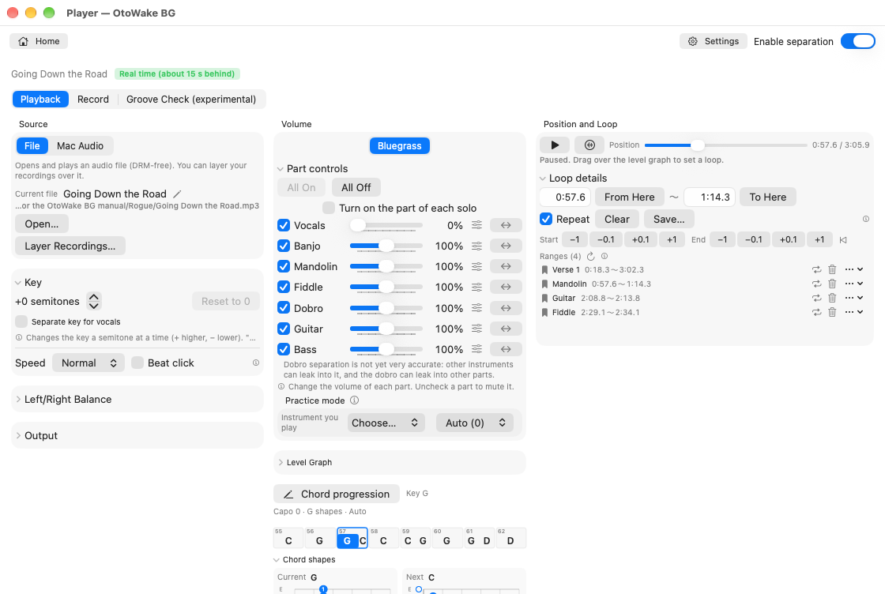

Ideas:

- Untick the part you play, and use the recording as your backing band.
- To hear one part alone, press "All Off", then tick that part.
- Turn up the instrument you want to learn, and check the phrase by ear.

The two buttons at the right of each row adjust that part's tone (the first: octave up or down, and low, mid and high levels) and its feel (the second, ↔: earlier or later timing).

Tick "Turn on the part of each solo" and, while a solo (break) found in the ranges plays, its instrument is heard even if its part is off. When the solo ends, the part goes back to how you set it.

**About the dobro.** Right under the part list, the app shows: "Dobro separation is not yet very accurate: other instruments can leak into it, and the dobro can leak into other parts." Trust the dobro part less than the others.

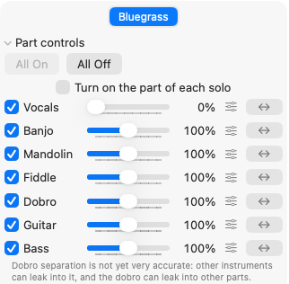

Every part carries a little of the others. With the vocals at 0%, a faint voice can remain.

### Practice mode

Under the part list, "Practice mode" asks for the "Instrument you play" (and the capo for guitar, banjo and dobro). Then press a preset button and the part levels are set all at once:

- "My break", "Backup", "Play along", "Rhythm only" and "Take mine out"

Choose a range first and press a preset, and you practise on that range.

### Level Graph

Click the "Level Graph" heading to see the level of each part that is on, from about 20 seconds ago to 10 seconds ahead, as lines.

### Instruments while singing

During singing, guitar strums and mandolin chops can slip into the vocal part and get quieter. In Advanced Settings (top right of the player), under "Separation", set "Instruments while singing" to "Give vocals none" to keep more of the instruments. The cost is that part of the voice stays in the instrument parts.

## 4. Speed and key

Speed and key are in the "Key" box on the left of the "Playback" tab (click its heading to open it).

### Speed

The "Speed" menu plays the song slower without changing its pitch. Choose "Normal", or from 90% down to 50%.

- An audio file simply plays slower.
- For a song in Music or another player, the app stores the sound it receives at normal speed and plays it slowly. The position you hear therefore falls further and further behind the real playback.

Tick "Beat click" to add a click on the beats the app has found. The first beat of each bar is higher and louder. Nothing sounds for the first ten seconds or so, until the beats are found.

### Key

The arrows beside "semitones" change the pitch in semitone steps (±12). "Reset to 0" puts it back.

Turn on "Separate key for vocals" to move the voice and the backing separately.

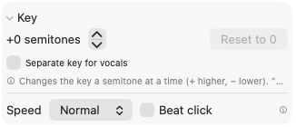

⌃⌥⇧↑ and ⌃⌥⇧↓ also change the key from anywhere.

## 5. Loops and ranges

### Repeat a passage

Use the "Position and Loop" box.

1. Open "Loop details".
2. While the song plays, press "From Here" where the passage starts and "To Here" where it ends. You can also type the times (for example 1:05.3).
3. Switch "Repeat" on.
4. For fine adjustment, use the −1, −0.1, +0.1 and +1 buttons for the start and the end, or drag on the level graph.
5. The button at the right end jumps to the start of the loop and repeats it.
6. "Save…" gives the loop a name, so you can call it up the next time you play the song ("A part", "Banjo break").
7. "Clear" ends the loop.

Above this box are the play and pause button and the position slider. The button beside them ("Hold the current sound") stops the song and holds the sound that is playing at that moment, so you can find the notes and chords on your instrument.

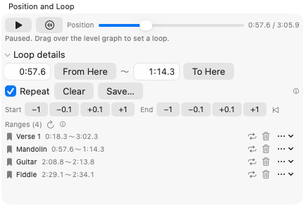

For files, the loop returns to the start without a gap. For Music, QuickTime Player and Spotify, OtoWake BG moves the player back itself. A song in a browser cannot be moved. The loop clears when the song changes.

### The ranges list

The "Ranges" list under the loop box shows:

- Breaks the app found (a stretch of 4 seconds or more where one part comes forward)
- Drafts of sung sections
- Loops you saved with "Save…"

Click a name to jump there. Point at a row and its buttons appear: repeat, save and delete. The "…" menu renames and joins ranges and widens their start or end. The arrow button beside the heading searches again (ranges you saved stay).

The app finds breaks and sung sections while the song plays. What it finds is a draft. The sung sections in particular are rough, and names and boundaries can be wrong. Listen and check.

For sources other than files, switch on "Auto range analysis" to find ranges while you listen. With "Auto-save" on, the ranges are saved with the song when the song ends, and the player moves on to the next one.

The picture below shows a list with just one range, saved by hand.

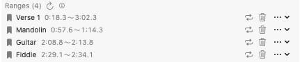

## 6. Key, tempo (BPM) and chords

Key, BPM and chords are estimates made from the sound. They can be wrong.

### Chords on the player

Lower on the "Playback" tab you see a "Chord progression" button, the estimated key ("Key E", for example), the capo, eight bars of chords (two rows of four if they do not fit), and "Chord shapes" with "Current" and "Next". The bar now playing is highlighted. The display follows your transposition and capo. Choose the capo ("Auto" or 0 to 12) in "Practice mode".

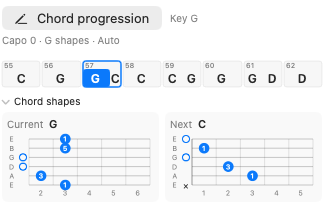

To fix a wrong chord, press "Chord progression" and write the chords in the original key. In the bar view you can put up to two chords in one bar, like "G D7". An empty bar continues the previous chord. You can set the BPM here too. In the advanced view you write "start time, chord" on each line. Chords you have corrected are not overwritten by the automatic estimate.

Chords are limited to major, minor and seventh. Thin backing, solo passages and quick chord changes are where it is most likely to be wrong.

### Tempo (BPM)

Tempo appears on the "Groove Check (experimental)" tab, as "Tempo: 160 BPM" for example. It can read double or half the real tempo.

## 7. Record yourself

Record your singing or playing along with a song, then hear the take together with the song later.

1. Put on headphones. If the song comes out of the speakers, it leaks into the microphone and the take will not line up.
2. Switch "Enable separation" on and play the song.
3. Open the "Record" tab and choose a "Microphone" under "My Recordings".
4. Tick "I'm listening on headphones".
5. Press "● Record". When you finish, press "■ Stop Recording".
6. Play the same song again and press "Play Along". The take plays in time with the song. Adjust "Volume" and "Offset".

Only the microphone is saved. The song is not.

You cannot record during buffered playback, or while the speed is lowered. The first time you record, macOS asks for microphone permission.

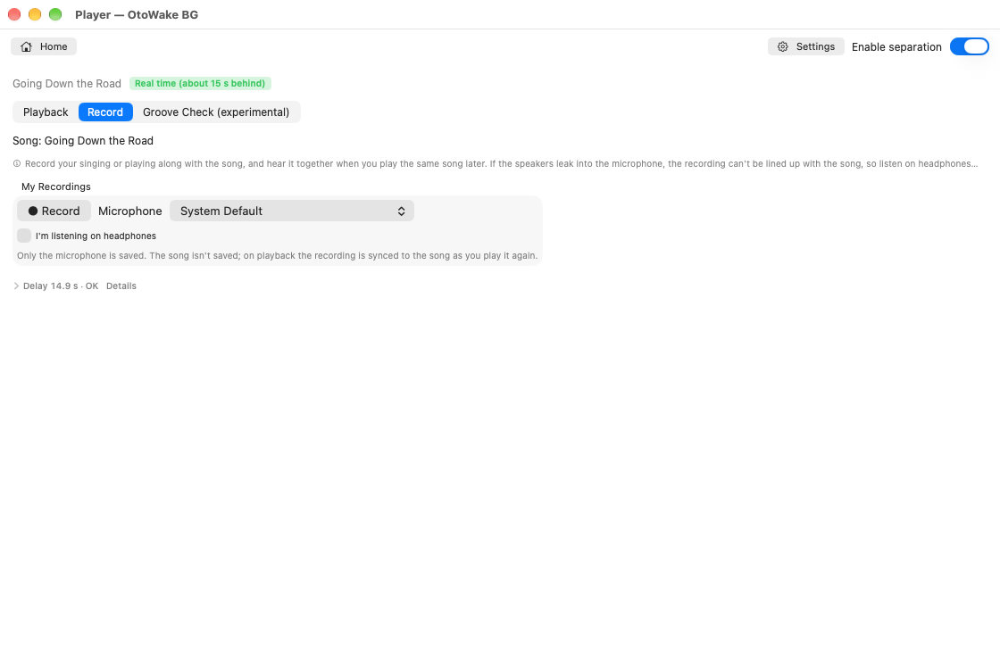

When a file is open, "Layer Recordings…" on the "Playback" tab lays your takes over the song so the whole performance can be measured together.

## 8. Tablature

Press "Tablature" at the top right of Home to open the tab window.

### The list, and new tabs

- Narrow the list on the left by "Book", instrument, favorites (the star button) or search.
- "New" at the bottom left makes an empty tab (guitar, mandolin, bass, banjo or dobro).
- "Import Files…" reads MusicXML, Power Tab, Guitar Pro and TablEdit files, and images or PDFs of tab.

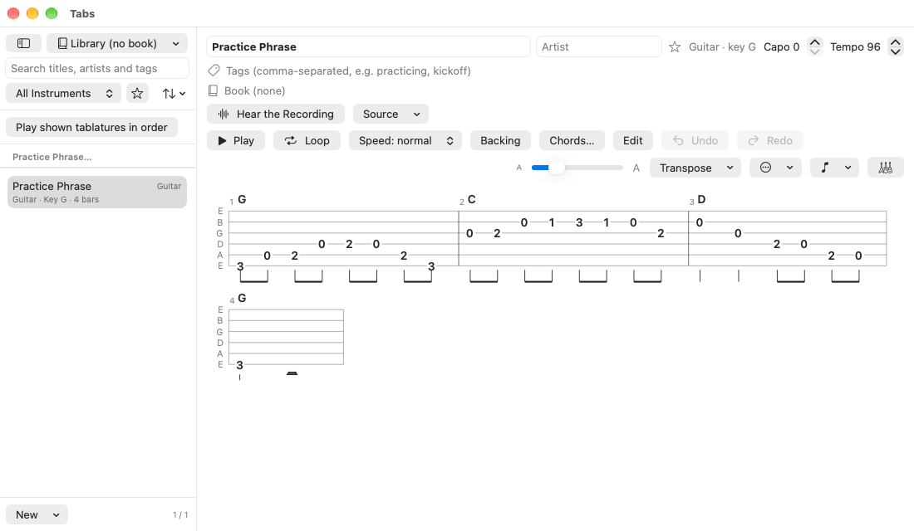

### Read tab from a photo or PDF

1. Choose "Import Files…" and pick an image or PDF of the tab.
2. The app reads what it can and makes a draft tab. It reads the rhythm only where it can.
3. Every bar carries a "?" mark. Use "Show the original picture" to put the original beside the draft, compare, and correct.
4. For each bar you have checked, use the "Bar" menu and choose "Clear the "?" Mark (Checked)".

Faint lines, or photos taken at a steep angle, may not be read. Handwritten tab has not been tried.

To photograph a page with a nearby iPhone camera, choose "Take with iPhone…" from the "New" menu. You need an iPhone on the same Apple Account nearby, with Wi-Fi and Bluetooth on and Continuity Camera turned on (iPhone Settings > General > AirPlay & Continuity). The first time, macOS asks for camera permission. After you take the pages, press "Make a Tab".

### View and listen

- "Play" plays the tab with instrument sounds. "Loop", "Speed" and "Backing" are there too.
- The fretboard button at the top right draws the fingering of the current bar. Click a string to hear that note.
- Under "Source", "Link Recording…" ties the tab to an audio file or a song in Music. Then "Hear the Recording" lets you compare with the separated real sound.

### Edit

1. Press "Edit". Editing buttons appear above the tab.
2. Select a note and type a number to set the fret. Arrows move the position and delete removes a note. H, P and S add hammer-on, pull-off and slide; T a tie; X a mute; N a harmonic.
3. The "Bar" menu copies and pastes bars, and changes time signatures and repeats.
4. "Chords…" rewrites the chord names of every bar as one piece of text.
5. If you slip, use "Undo" and "Redo".

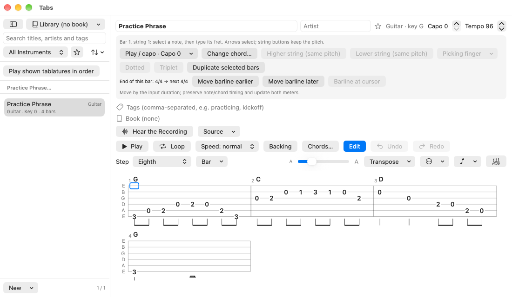

### Transpose and export

- "Transpose" saves a copy in another key as a separate tab.
- Under "More" (the "…" button), "Export MusicXML…" and "Export Guitar Pro 5…" hand the tab to other software.

## 9. Experimental features

These features are marked "experimental". Read "Experimental features" in the Release Notes first.

### Groove Check (experimental)

The "Groove Check (experimental)" tab measures where each instrument plays within the beat ("Groove"), plus the rhythm spread and the pitch of the singing ("Check").

1. Switch "Enable separation" on and play a song.
2. Open the "Groove Check (experimental)" tab. The display starts after about 12 seconds of listening.
3. "Groove" shows the feel of the song (for example "Far behind the beat"), the tempo and the beat wobble. The "Position within the beat" chart shows where bass, guitar, mandolin and banjo play between the bass's "boom", the mandolin's "chuck" and the next "boom".
4. "Check" shows the rhythm spread and the vocal pitch. Until they can be measured it says "Not measured yet".

The numbers are guides. If a song separates badly, the numbers are not reliable either. Vocal pitch is shown once 8 or more notes have been measured.

Turn on "Save performance measurements" and the numbers are kept per song even when this tab is closed (no audio is saved). Songs measured for 30 seconds or more can be reviewed under "Song to show". "Delete All History…" removes them.

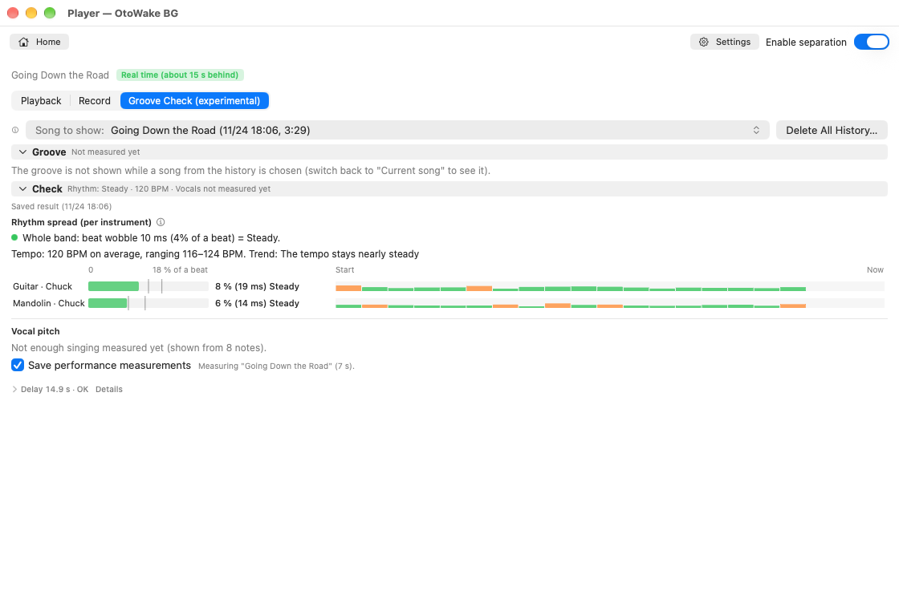

### AI transcription over MCP (experimental)

Transcription is done by an AI assistant that you set up (one that supports MCP and can change its own settings). The app does not transcribe by itself.

**Connect it**

1. Open "Advanced Settings" (top right of the player). "General" has "MCP settings (experimental)".
2. Press "Copy MCP Setup Request for AI".
3. Paste it into your AI assistant's chat. The assistant registers the OtoWake BG MCP server itself, under the name "otowake-bg".
4. If you would rather write it into the AI app's settings yourself, use "Copy Settings (JSON)".
5. In the same box, switch on "Show “Ask AI to Transcribe” buttons in the player". It starts off. Until you switch it on, the player shows no transcription buttons.

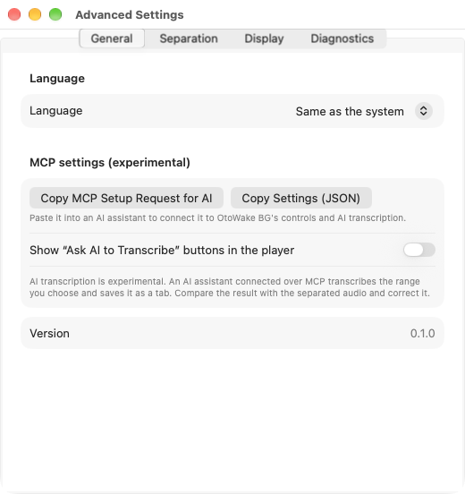

**Ask for a transcription**

1. Play the song so that breaks and other ranges appear in the "Ranges" list.
2. On a range row, press "Ask AI to Transcribe" and choose the part. A request is copied.
3. Paste the request into your AI assistant's chat.
4. When the AI saves its transcription, it appears in the tab window.

For a song played through "Mac Audio", the app keeps the last 5 minutes of separated sound in memory when the song ends, so you can ask again right away.

The assistant receives numbers: beats, note names and note candidates. The note candidates are picked from the audio by a simple method and are not very accurate. The AI's transcription can contain many wrong notes and fingerings that cannot be played. Always check it by ear and correct it.

The app does not send audio on its own. However, the separated sound of the range you selected is stored on this Mac, and the assistant can ask for it, up to 30 seconds at a time.

## 10. Troubleshooting

**Nothing is captured.** If "System audio recording is not allowed." appears, press "Open Settings" and allow OtoWake BG under Screen & System Audio Recording. With "A specific app", make sure the song is playing in that app, and press "Refresh Lists".

**You cannot hear the singing.** In a new song "Vocals" starts at 0%. Raise the "Vocals" slider in "Part controls".

**The sound breaks up.** Close heavy apps. In Advanced Settings > "Separation" > "When Processing Can't Keep Up", set "Playback" to "Always buffer". If capture stopped at the memory limit, switch separation off and on again.

**You cannot choose "Bluegrass".** If "No separation model" appears, reinstall the app (the model comes with it).

**A loop does not jump back.** Allow control of Music or the player when macOS asks. A song in a browser cannot be moved.

**The window is gone.** Open it from the menu bar icon, with ⌃⌥⇧O, or from the Dock icon.

**"(not found)" beside a file.** The file has moved. Choose it again with "Open…". Play DRM tracks through "Mac Audio".

**Your take has the song in it.** The speakers are feeding the microphone. Use headphones.

**Reporting an error.** "Copy Details" on the error message copies what we need. Where to send feedback is in the [Release Notes](release-notes.md).

## Appendix: shortcuts

| Action | Keys |
|---|---|
| Open or close the control panel as a window | ⌃⌥⇧O |
| Switch separation on or off | ⌃⌥⇧K |
| Key up / down | ⌃⌥⇧↑ / ⌃⌥⇧↓ |

If another app already uses a shortcut, it may not register. Advanced Settings > "Display" tells you.
