# OtoWake BG User Guide — Windows

This guide shows how to use the features in the Windows edition of OtoWake BG. Before you start, read "Things to know before you use it" in the [Release Notes](release-notes.md).

Names of buttons and screens appear in quotation marks. If a name looks different on your screen, your version of the app may differ.

## 1. Install and first launch

### What you need

- Windows 11 (x64)
- A DirectX 12 graphics card is recommended. The app also runs on the CPU alone, but it may fall behind.
- Audio you are allowed to use: an audio file, or sound playing on the PC

### Install

OtoWake BG comes as a setup file (`OtoWakeBG-Setup-<version>-win-x64.exe`). The setup speaks English or Japanese, following the display language of Windows.

1. Double-click the `OtoWakeBG-Setup-<version>-win-x64.exe` you downloaded. You need no administrator rights and no extra .NET installation.
2. Choose whether to create a desktop shortcut, then press "Next" and "Install".
3. Press "Finish" to start OtoWake BG (untick the box first if you do not want to start it now).

The setup is not signed by its developer, so Windows may say "Windows protected your PC". If so, press "More info", then "Run anyway".

Opening the setup of a newer version replaces the OtoWake BG you have. Your settings and data are kept. If OtoWake BG is running, the setup asks to close it.

OtoWake BG installs into `%LOCALAPPDATA%\Programs\OtoWake BG`, and a folder called "OtoWake BG" appears in the Start menu. The separation model comes with the app.

Settings and saved data are kept in `%APPDATA%\OtoWake BG` and `%LOCALAPPDATA%\OtoWake BG`.

### Launch

Start OtoWake BG from the "OtoWake BG" folder in the Start menu (the executable is `OtoWakeBG.exe`). Window titles end in "OtoWake BG", as in "Home — OtoWake BG" and "Player — OtoWake BG".

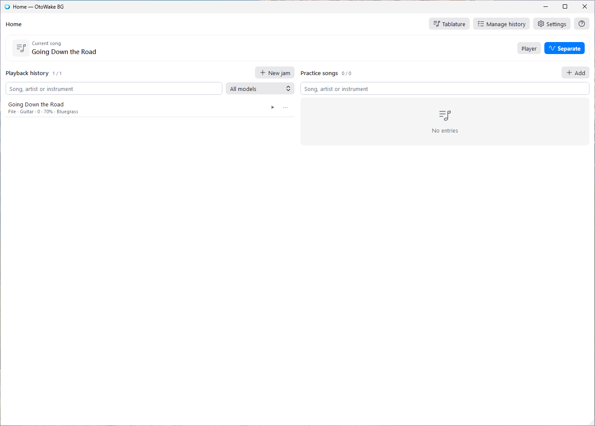

### Uninstall

Use "Uninstall OtoWake BG" in the Start menu folder (named in Japanese if you installed in Japanese), or Installed apps in Windows Settings. Your settings and recordings are kept.

### When you close the window

Closing the window does not quit OtoWake BG: it keeps running in the notification area, near the clock. Click its icon to bring the window back. To quit for good, right-click the icon and choose "Quit". The audio output goes back to normal at that point.

- Ctrl+Alt+Shift+O: show the window
- Ctrl+Alt+Shift+K: switch separation on or off

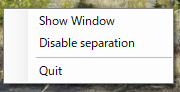

## 2. Getting sound in

### The basics

On Home, choose "New jam" under "Playback history" to open the player. Switch "Enable separation" on at the top. Sound starts after a few seconds, sometimes more than ten. On a PC without a GPU it can take about 30 seconds. A model you use for the first time takes longer.

The top row shows the playback method (real time or buffered) and the delay.

If the separation model cannot be found, the app says so and plays with the simple separation that needs no AI ("Simple split (no AI)", which cancels what sits in the centre). In that case, reinstall OtoWake BG.

### Use an audio file

1. On the "Play" tab, set "Source" to "File".
2. Press "Open File…" and choose an audio file without DRM (copy protection). It plays from the start.
3. Opening the file starts the separation ("Enable separation" turns on).

Files you played before are on Home under "Playback history". "Rename…" changes the name shown in the history (the file itself is not renamed).

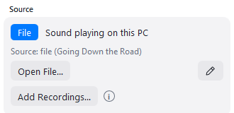

### Use sound playing on the PC

1. Set "Source" to "Sound playing on this PC".
2. With "Automatically capture apps playing audio" ticked, the app captures every app that is playing sound. Windows notification sounds are not processed and play as they are.
3. To capture a single app, untick it. "App or device to capture" then lists the apps that are playing sound. If yours is missing, press "Refresh" and pick it.
4. Play a song and switch "Enable separation" on.

You do not need to touch the Windows volume mixer.

Browser audio works the same way. Protected audio, or apps with unusual audio methods, may not be captured. If nothing comes in, the app says the input is silent.

With "Sound playing on this PC" you can go back up to 2 minutes. Press "Back to live" to return to the sound now playing.

### Choose where it plays

Under "Output", choose the speakers or headphones you will actually listen on. Press "Refresh" if the list is out of date.

### About the delay

Because the app captures and splits the sound, you hear it later than the original. As a guide: 6 seconds, plus twice the processing time, plus 0.75 seconds. With video, the sound lags behind the picture. "Real time" does not mean zero delay.

When you open a file, the app separates the song twice and averages the results (Settings > "Separation" tab > "Separate files twice and average"), which adds 6 to 7 seconds. Switch that setting off to shorten the delay. The trade-off is that how the instruments are divided can wobble with where the song is cut into chunks.

## 3. Change the volume of each part

1. Check that "Separation" is set to "Bluegrass".
2. Open "Part controls". Each part has a check box and a volume slider.
3. Untick a part to silence it. Move the slider to change its level.
4. "All on" and "All off" switch everything at once.

Ideas:

- Untick the part you play, and use the recording as your backing band.
- To hear one part alone, press "All off", then tick that part.
- Turn up the instrument you want to learn, and check the phrase by ear.

The ten parts are vocals, banjo, mandolin, fiddle, dobro, guitar, bass, drums, piano and other.

A change to a volume or to a part's on/off state usually takes one to two seconds to be heard.

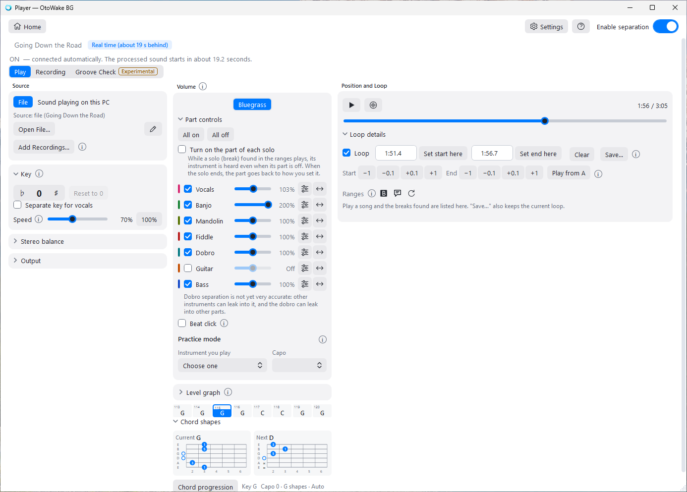

**About the dobro.** Dobro separation is still low in accuracy. Other instruments can end up in the dobro part, and the dobro can end up in other parts.

Every part carries a little of the others. With the vocals at 0%, a faint voice can remain.

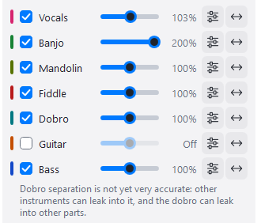

### Instruments while singing

During singing, guitar and mandolin can slip into the vocal part and get quieter. In Settings, on the "Separation" tab, set "Instruments while singing" to "Give the vocals none" to keep more of the instruments. The cost is that part of the voice stays in the instrument parts. A change takes effect from the next processing block.

### Practice tools

- **Practice mode.** Choose the "Instrument you play" and preset buttons appear. Press one and the part levels are set all at once. Choose a range first and you practise on that range.
- **Hold Sound.** After you stop the song with "Pause" in the "Play" box, press "Hold Sound" to hold the sound at the moment you stopped. Use it to find notes and chords on your instrument.
- **Beat click.** Adds a click on the beats the app has found. The first beat of each bar is higher and louder.
- **Level graph.** Draws the level of each part that is on as lines.
- The ♪ beside each part adjusts its tone (octave, and low, mid and high levels); ↔ adjusts its feel (earlier or later timing).

## 4. Speed and key

### Speed

"Speed" plays the song slower without changing its pitch (50 to 100%).

- An audio file simply plays slower.
- A song in a player can be slowed only if the player can be paused (Media Player, Spotify, a browser and similar). Sound that cannot be paused stays at normal speed.

### Key

The ♯ and ♭ buttons under "Key" change the pitch in semitone steps. "Reset to 0" puts it back.

Turn on "Separate key for vocals" to move the voice and the backing separately. If you turn on "Change the key with shortcuts" on the "Display" tab of Settings, Ctrl+Alt+Shift+↑ and Ctrl+Alt+Shift+↓ also change the key.

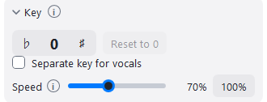

## 5. Loops and ranges

### Repeat a passage

1. Open "Loop details".
2. While the song plays, press "Set start here" where the passage starts and "Set end here" where it ends. You can also type the times (at least 0.5 seconds).
3. Switch "Loop" on.
4. The −1, −0.1, +0.1 and +1 second buttons fine-tune each end.
5. "Play from A" plays the loop from its start.
6. "Save…" gives the loop a name and keeps it with the song ("A part", "Banjo break").
7. "Clear" ends the loop.

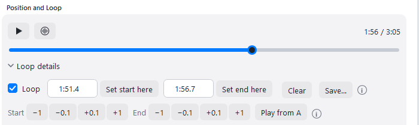

### The ranges list

The "Ranges" list shows:

- Breaks the app found (a stretch of 4 seconds or more where one part comes forward)
- Drafts of sung verses and choruses
- Loops you saved with "Save…"

Click a name to jump there. Point at a row and its icons appear: "Repeat", "Rename", "Join with Above", "Join with Below", "Extend Start", "Extend End", save, and "Remove from List". The app finds ranges only with "Bluegrass".

For an audio file, the list fills in as the song plays with separation on. With "Sound playing on this PC", switch on "Auto range analysis". With "Auto save" on, the ranges are saved with the song when it ends, and the player moves on to the next one.

"Detect ranges again" runs the search again and keeps the ranges you saved. "Save all found ranges" saves them in one go.

Found ranges are drafts. Names and boundaries can be wrong. Listen and check.

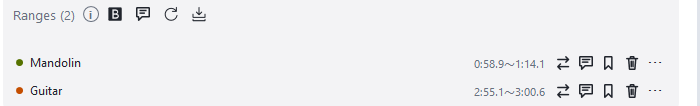

## 6. Chords and tempo (BPM)

Chords and tempo are estimates made from the sound. They can be wrong.

### Chords on the player

With "Separation" set to "Bluegrass", the player shows the chord progression (eight bars on one row, or two rows of four if narrow) and "Chord shapes" with "Current" and "Next". In Bluegrass the app saves the estimated progression for each song.

To fix a wrong chord, press "Chord progression" and enter the chords of each bar in the original key. Put up to two chords in a bar, separated by a space, like "G D7". An empty bar continues the previous chord. Chords you have corrected are not overwritten by the automatic estimate. For guitar, banjo and dobro, "Capo" in practice mode can be "Auto" or 0 to 12.

Chords are limited to major, minor and seventh. Thin backing, solo passages and quick chord changes are where it is most likely to be wrong.

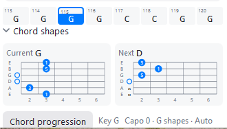

### Tempo (BPM)

Tempo appears on the "Groove Check" tab (experimental) as "Tempo: average … BPM". It can read double or half the real tempo.

## 7. Record yourself

Record your singing or playing along with a song, then hear the take together with the song later.

1. Put on headphones. If the song comes out of the speakers, it leaks into your recording.
2. Switch "Enable separation" on and play the song.
3. Open the "Recording" tab and choose a "Microphone". If the microphone is blocked, press "Open microphone settings" and allow desktop apps to use it in Windows settings.
4. Tick "I'm listening on headphones".
5. Press "● Record". When you finish, press "■ Stop Recording".
6. The take is added to the list. Play the same song again and press "Play Along". The take plays in time with the song.

Each take has its own volume (0 to 200%) and a timing offset (in steps of 10 ms). Bluetooth headphones add a lot of delay. If the timing will not line up, try wired headphones and a wired microphone.

Only the microphone is saved. The song is not.

You cannot record during buffered playback, during a loop, or while the speed is lowered.

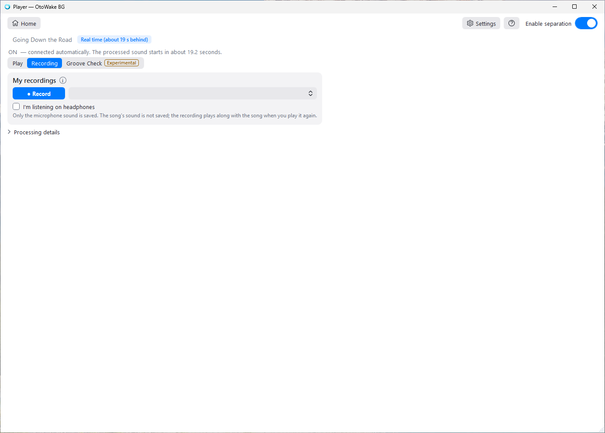

When a file is open, "Add Recordings…" lays your takes over the song so the whole performance can be measured together.

## 8. Tablature

Press "Tablature" in the Home header to open the tab window.

### The list, and new tabs

- Search by title, artist, tag or key. Narrow the list by instrument, favorites or tag. "Book" groups tabs.
- You can make a new empty tab, "Duplicate" one, or "Import MusicXML, Power Tab, Guitar Pro or TablEdit…".
- Select several with Ctrl or Shift to delete them together.

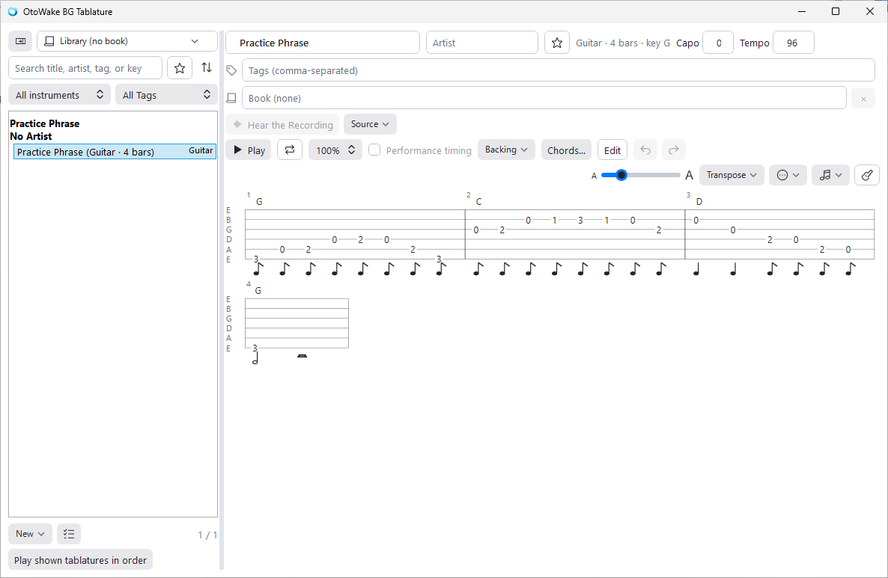

### Read a paper tab

1. Press "Scan with camera".
2. Hold the page up to the camera and take the picture.
3. The app reads what it can and makes a draft tab.
4. Every bar carries a "?" mark. Compare with the original page and correct it.

Reading a paper tab needs English text recognition to be installed in Windows. If it is missing, the app says it cannot use text recognition and asks you to add English text recognition to Windows.

For image and PDF files of tab, ask your AI assistant, as described under the experimental AI transcription (see "9. Experimental features").

### View and listen

- "Count-in (2 bars)", "Loop the bar range", "Speed", "Bass backing" and "Guitar backing" help you practise.
- "Fretboard" draws the fingering of the current bar. Click a string to hear that note.
- "Link Recording…" ties the tab to the original recording, and then "Play tab over the song" is available.

### Edit

1. Click the tab to place the cursor and type a number to set the fret (two digits are fine). Arrows move, and Delete removes a note.
2. Shift+click selects a range of bars.
3. H, P, S, N, X and T add hammer-on, pull-off, slide, harmonic, mute and tie. [ and ] change the note length.
4. "Save Ctrl+S" saves. Undo and redo work too.

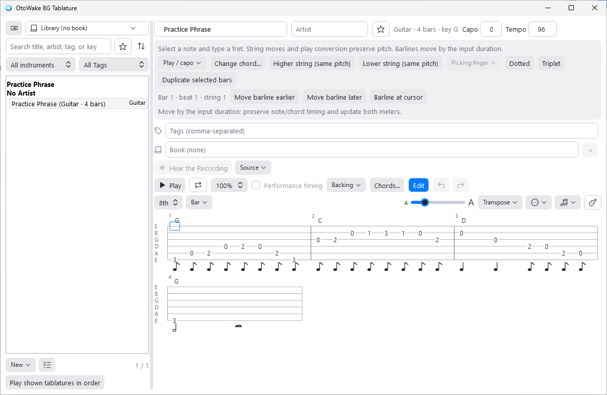

### Transpose and export

- "Transpose and save" keeps a copy in another key as a separate tab. "Keep fingering" is available.
- "Save MusicXML…", "Save Guitar Pro 5…" and "Save Text…" hand the tab to other software.

## 9. Experimental features

These features are marked "Experimental". Read "Experimental features" in the Release Notes first.

### Groove Check (experimental)

The "Groove Check" tab (it carries an "Experimental" badge) measures where each instrument plays within the beat ("Groove"), plus the rhythm spread and the pitch of the vocals ("Check").

1. Set "Separation" to "Bluegrass", switch separation on and play a song.
2. Open the "Groove Check" tab.
3. The "Groove" chart shows where each instrument plays between the bass's "boom", the mandolin's "chuck" and the next "boom".
4. "Check" shows the rhythm spread and the vocal pitch.

The numbers are guides. If a song separates badly, the numbers are not reliable either. Singing appears on the chart once 8 or more notes have been measured.

Once 30 seconds or more of a song have been measured, it goes into the history. Under "Song to show" you can choose the current song or one from the history. Turn on "Save performance measurements" and the numbers are kept per song even when this tab is closed (no audio is saved). "Delete all history…" removes them.

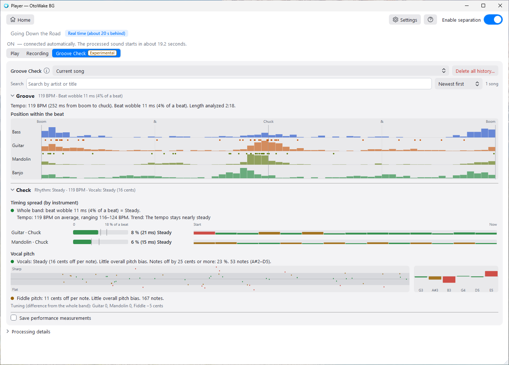

### AI transcription over MCP (experimental)

Transcription is done by an AI assistant that you set up (one that supports MCP and can change its own settings). The app does not transcribe by itself.

**Connect it**

1. Open "Settings" and go to the bottom of the "Diagnostics" tab: "Transcription by an AI assistant (MCP)" (experimental) is there.
2. Press "Copy request for AI to register MCP".
3. Paste it into your AI assistant's chat. The assistant registers the OtoWake BG MCP server itself, under the name "otowake-bg".
4. If you would rather write it into the AI app's settings yourself, use "Copy settings (JSON)".

After you update OtoWake BG, restart the AI app you connected as well.

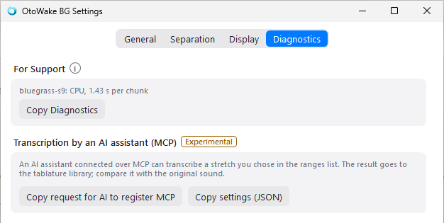

**Ask for a transcription**

1. Play the song so that breaks and other ranges appear in the "Ranges" list.
2. On a range row, press "Ask AI to Transcribe" and choose the part. A request is copied.
3. Paste the request into your AI assistant's chat.
4. Keep OtoWake BG running. When the AI saves its transcription, it appears in the tab window.

With "Sound playing on this PC" and "Auto range analysis" on, the app keeps the last 5 minutes of separated sound in memory, so you can still ask for ranges you have already played.

The assistant receives numbers: beats, note names and note candidates. The note candidates are picked from the audio by a simple method and are not very accurate. The AI's transcription can contain many wrong notes and fingerings that cannot be played.

The app does not send audio on its own. However, the separated sound of the range you selected is stored on this PC, and the assistant can ask for it, up to 30 seconds at a time. Always check the AI's transcription by ear.

**Read an image or PDF of tab**

Give your AI assistant the image or PDF file of the tab and ask it to read it. The AI makes a draft and corrects it against pictures of each staff. Reading needs English text recognition in Windows. Bars in the draft carry a "?" mark, which goes away as the AI confirms them.

## 10. Troubleshooting

**No sound after switching on.** Check that "Output" is the speakers or headphones you actually use, and press "Refresh". Check that the song is playing in its source app. For a file, try a DRM-free audio file. Wait until the model has loaded and the first speed measurement has finished.

**Sound from the PC does not come in.** Try "Automatically capture apps playing audio". To use one app, press "Refresh" and pick it again. Protected audio, or apps with unusual audio methods, cannot be captured. Also check the Windows volume mixer, the playback device and whether the app is muted.

**The sound breaks up or lags.** Processing may not be keeping up with your PC. Press "Use buffered playback", or set "Playback" on the "Separation" tab of Settings to "Auto" (Auto buffers the sound first when the load is high). "Real time" gives the smallest delay but breaks up if the PC is too slow. Try switching "Use the GPU (DirectML)" on or off.

**"AI processing is failing."** Press "Switch to CPU", or restart OtoWake BG.

**One instrument cannot be heard.** Check that "Separation" is "Bluegrass", that the instrument's box is ticked, and that its slider is not at 0. Some sound can remain in the wrong part.

**Your take has the song in it.** The speakers are feeding the microphone. Use headphones, and check the microphone level before recording.

**You cannot record.** Press "Open microphone settings" and allow desktop apps to use the microphone. Check the microphone you chose, too.

**The window is gone.** Click the icon in the notification area, or press Ctrl+Alt+Shift+O.

**Contacting us.** "Copy Diagnostics" on the "Diagnostics" tab of Settings copies your settings, device names, model status and recent logs. It contains no audio or song names, but file locations can contain your Windows user name, so read it before you send it. Where to send feedback is in the [Release Notes](release-notes.md).

## Appendix: shortcuts

| Action | Keys |
|---|---|
| Show the window | Ctrl+Alt+Shift+O |
| Switch separation on or off | Ctrl+Alt+Shift+K |
| Key up / down | Ctrl+Alt+Shift+↑ / Ctrl+Alt+Shift+↓ (when "Change the key with shortcuts" is on, on the "Display" tab of Settings) |
| Save a tab | Ctrl+S |

If another app already uses a shortcut, it may not register. The status line at launch and Settings tell you.
