# OtoWake BG 使い方（Mac 版）

この手引きは、OtoWake BG の Mac 版で、この版にある機能を使うための手順をまとめたものです。使う前に、[リリースノート](release-notes.md)の「留意事項」を読んでください。

画面の名前は「　」で囲んで書いています。画面の名前が違って見えるときは、アプリのバージョンの違いかもしれません。窓の名前は、「ホーム — OtoWake BG」「再生画面 — OtoWake BG」のように、「OtoWake BG」で終わります。

## 1. インストールと最初の起動

### 必要なもの

- macOS 14.2 以降の、Apple シリコンの Mac（Intel の Mac では動きません）
- 使うことを許された音声（音声ファイル、または Mac で再生中の音）

OtoWake BG は無料です。

### インストール

OtoWake BG は、インストーラーのファイル（`OtoWakeBG-<バージョン>-mac.pkg`）で届きます。インストーラーの画面は、Mac の言語に合わせて日本語か英語で出ます。

1. ダウンロードした `.pkg` ファイルをダブルクリックします。
2. 画面の案内に従って「続ける」を押し、「インストール」を押します。
   - 「インストール先」で「自分専用にインストール」を選ぶと、管理者のパスワードなしで、ホームの「アプリケーション」フォルダ（`~/Applications`）に入ります。
   - 「このコンピュータのすべてのユーザ用にインストール」では「アプリケーション」フォルダに入ります。管理者のパスワードを聞かれます。
3. 終わったら「閉じる」を押し、「アプリケーション」フォルダの OtoWake BG を開きます。

> [!CAUTION]
> **インストーラーとアプリには、開発元の署名がありません。** そのため、開くときに macOS が「開かれませんでした」と警告します。
>
> - 警告が出たら「完了」を押します（「ゴミ箱に入れる」は押さない）。続けて「システム設定」の「プライバシーとセキュリティ」を開き、下のほうに出る OtoWake BG の「このまま開く」を押して、ログインパスワード（または Touch ID）で許可します。
> - macOS 14 では、Control キーを押しながらクリックして「開く」を選んでも開けます。
> - アプリを開くときに同じ警告が出たときも、同じようにします。
> - 心配なときは、開く前に、配布ページの SHA-256 でファイルを確かめてください。

新しいバージョンのインストーラーを開くと、入っている OtoWake BG が置き換わります。設定とデータはそのまま残ります。

### アンインストール

OtoWake BG を終了してから、「アプリケーション」フォルダの OtoWake BG をゴミ箱に入れます。設定とデータも消すときは、`~/Library/Application Support/OtoWake BG/` もゴミ箱に入れます。

### 最初の起動

起動すると、最初の画面「ホーム」が開きます。メニューバーにもアイコンが出ます。

- 左の「再生履歴」には、これまでに流した曲が並びます。「新しく始める」を押すと、再生画面が開きます。
- 右の「練習曲」には、曲と楽器、キー、速さを登録できます。
- 見出しの右には、「タブ譜」「履歴管理」「詳細設定」が並びます。

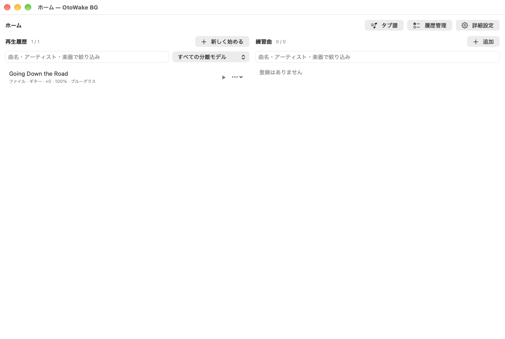

アプリの窓が見つからなくなったときは、次のどれかで開けます。

- メニューバーのアイコン
- ⌃⌥⇧O（操作パネルを窓として開閉）
- Dock のアイコン（詳細設定の「表示」で「Dock にアイコンを表示」をオンにしたとき）

設定、履歴、タブ譜、録音は、`~/Library/Application Support/OtoWake BG/` に保存されます。

### 許可（Mac の音を取り込むとき）

Mac で再生中の音を取り込むときだけ、macOS の許可が要ります。音声ファイルを開くだけなら、この許可は要りません。

1. ホームの「再生履歴」の「新しく始める」を押して、再生画面を開きます。
2. 「再生」タブの「再生元」で、「Macの音」を選びます。
3. 再生画面の上のほうに出る「はじめに」の欄で、「許可する」を押します。macOS の確認が出たら、許可します。

「はじめに」の欄には、「許可する」「曲を流す」「分離を有効化」の 3 つの手順が出ます。「許可する」の行は、「再生元」で「Macの音」を選んだときに出ます。「ファイル」を選んでいるときは出ません。

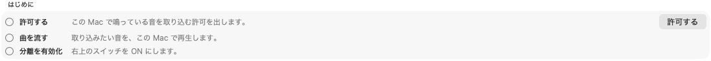

許可が出ていないと、「システムオーディオの収録が許可されていません。」と表示されます。その場合は、「設定を開く」を押し、「システム設定」の「プライバシーとセキュリティ」の「画面収録とシステムオーディオ録音」で、OtoWake BG をオンにします。

取り込んだ音は保存しません。

## 2. 音を入れる

### 再生画面の基本

再生画面の右上の「分離を有効化」のスイッチをオンにすると、分離が始まります（⌃⌥⇧K でも切り替えられます）。音が出るまでには、時間がかかります（下の「遅れについて」を見てください）。

再生画面には、「再生」「録音」「ノリ・チェック (試験的)」の 3 つのタブがあります。曲名の横には、処理の方式と遅れが、「リアルタイム (約 16 秒遅れ)」のように表示されます。

### 音声ファイルを使う

1. 「再生」タブの「再生元」で、「ファイル」を選びます。
2. 「開く…」を押して、DRM（コピー防止）のない音声ファイルを選びます。ファイルは先頭から流れます。
3. 「分離を有効化」をオンにします。

Finder の「このアプリケーションで開く」や、アプリのアイコンへのドロップでも、音声ファイルを開けます。

前に流したファイルは、ホームの「再生履歴」から選べます。履歴から消しても、元のファイルは消えません。

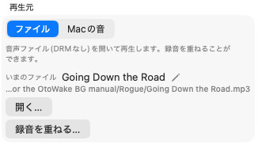

### Mac で再生中の音を使う

1. 「再生元」で、「Macの音」を選びます。
2. 「取り込む音」を選びます。
   - 「Mac全体の音」：音楽アプリやブラウザなど、Mac で流れている音をまとめて取り込みます。通知音も含みます。
   - 「アプリを指定」：選んだアプリの音だけを取り込みます。アプリを選んでから、そのアプリで曲を流します。一覧に出ないときは「一覧を更新」を押します。
3. 曲を流して、「分離を有効化」をオンにします。

Mac のサウンド出力の設定は、変えなくてかまいません。取り込む側のアプリの音は取り込みの時点で消え、分けたあとの音だけが鳴ります。

「Macの音」では、直近 2 分まで戻って聴けます。「ライブに戻る」を押すと、いまの音に戻ります。

### 出力を選ぶ

「出力」の欄（見出しを押すと開きます）で、鳴らす先を選びます。「システムの既定」なら、ヘッドホンをつなぐと自動でそちらに切り替わります。

### 遅れについて

音を取り込んで分けるため、分けた音は元の音より遅れて聞こえます。曲名の横の表示（「リアルタイム (約 16 秒遅れ)」など）が、そのときの遅れです。動画と一緒に使うと、映像より音が遅れます。

ファイルを開いたときは、曲を 2 回分けて平均するため（詳細設定の「分離」の「ファイルは 2 回分けて平均する」）、遅れが約 15 秒になります。この設定をオフにすると、6〜7 秒短くなります（約 8 秒）。そのかわり、楽器の分かれ方が曲の区切り位置で揺れやすくなります。

## 3. パートの音量を変える

「再生」タブの「音量」の欄で、パートごとの音量を変えます。

1. 「分け方」は「ブルーグラス」です。
2. 「パート別の調整」に、パートが並びます。ボーカル、バンジョー、マンドリン、フィドル、ドブロ、ギター、ベースです。分けた残り（ドラム、ピアノ、その他）は、一覧には出ません。
3. チェックを外すと、そのパートが消えます。スライダーで音量を変えます。
4. 「全部オン」「全部オフ」で、まとめて切り替えられます。

**新しい曲を開いたときは、「ボーカル」が 0% から始まります。** 歌が小さい（聞こえない）のは、故障ではありません。歌を聴きたいときは、「ボーカル」のスライダーを上げてください。

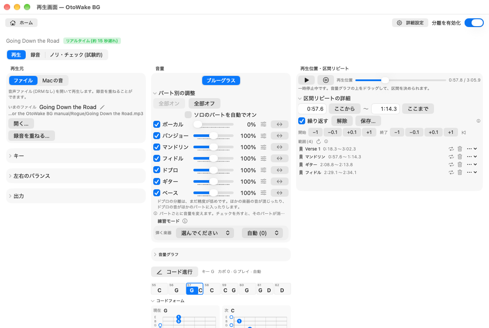

使い方の例です。

- 自分のパートを消して、その録音を伴奏にして弾く。
- 聴きたいパートだけを聴くには、「全部オフ」を押してから、聴きたいパートをオンにします。
- 聴き取りたい楽器を上げて、フレーズを耳で確かめる。

各行の右にある 2 つのボタンは、そのパートの音色（♪：オクターブの上下、低・中・高の音量）と、ノリ（↔：前後のタイミング）の調整です。

「ソロのパートを自動でオン」にチェックを入れると、範囲の一覧で見つかったソロ（ブレイク）が流れているあいだ、そのソロの楽器を、パートをオフにしていても鳴らします。ソロが終わると、元の設定に戻ります。

**ドブロについて**：パート一覧のすぐ下に、「ドブロの分離は、まだ精度が低めです。ほかの楽器の音が混じったり、ドブロの音がほかのパートに入ったりします。」と表示されます。ドブロの音は、ほかのパートよりあてになりません。

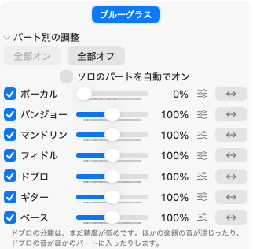

分けた音には、ほかのパートの音が少し混ざります。ボーカルを 0% にしても、声が薄く残ることがあります。

### 練習モード

パート一覧の下の「練習モード」では、「弾く楽器」（と、ギター、バンジョー、ドブロのカポ）を選んでから、プリセットのボタンを押します。パートの音量がまとめて設定されます。

- 「自分のブレイク」「バックアップ」「一緒に弾く」「リズムだけ」「自分の楽器を抜く」

区間を選んでから押すと、その区間で練習できます。

### 音量グラフ

「音量グラフ」の見出しを押すと、オンのパートの音量が、約 20 秒前から 10 秒先まで、線で表示されます。

### 歌の間の楽器の音

歌っている間に、ギターのストロークやマンドリンのチョップが、ボーカルに入って小さくなることがあります。そのときは、詳細設定（再生画面の右上）の「分離」にある「歌の間の楽器の音」で、「ボーカルには配らない」を選ぶと、楽器の音が残りやすくなります。そのかわり、声の一部が楽器の側に残ります。

## 4. 速さとキーを変える

「再生」タブの左の「キー」の欄（見出しを押すと開きます）に、キーと速さがあります。

### 速さ

「速さ」のメニューで、曲をゆっくり再生します。「そのまま」と、90% から 50% までを選べます。音の高さは変わりません。

- 音声ファイルは、そのまま遅くなります。
- ミュージックなどで流している曲は、元の速さで届く音をためながら遅く鳴らします。そのため、聞いている位置が、実際の再生より少しずつ遅れます。

「拍のクリック」にチェックを入れると、見つけた拍に、クリックの音を重ねます。小節の頭は高く、大きく鳴ります。拍が見つかるまでの、曲の頭の十数秒は鳴りません。

### キー

「キー」の上下の矢印で、曲の高さを半音ずつ変えます（±12 半音）。「0 に戻す」で元に戻ります。

「ボーカルを別のキーにする」をオンにすると、歌と伴奏を別々に変えられます。

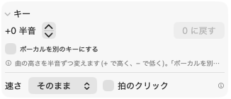

ショートカットとして、⌃⌥⇧↑ と ⌃⌥⇧↓ でもキーを変えられます。

## 5. 区間リピートと範囲

### 区間を繰り返す

曲の一部を繰り返して聴けます。「再生位置・区間リピート」の欄を使います。

1. 「区間リピートの詳細」を開きます。
2. 曲を流して、始めたい位置で「ここから」、終わりたい位置で「ここまで」を押します。数字を直接書き換えることもできます（「1:05.3」のように書きます）。
3. 「繰り返す」をオンにします。
4. 位置を細かく合わせるには、開始と終了の −1、−0.1、+0.1、+1 のボタンや、音量グラフの上のドラッグを使います。
5. 右端のボタンを押すと、区間の頭へ飛んで、繰り返して鳴らします。
6. 「保存…」で名前を付けると、次にこの曲を流したときも呼び出せます（「A パート」「バンジョーのブレイク」など）。
7. やめるときは、「解除」を押します。

欄の上には、再生と一時停止のボタンと、再生位置のつまみがあります。その横のボタン（「いまの音を伸ばす」）を押すと、曲を止めて、いま鳴っている音を伸ばし続けます。音やコードを楽器で探すときに使います。

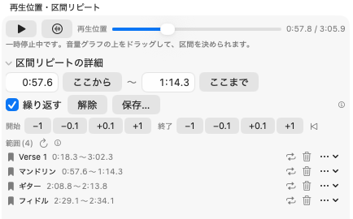

ファイルでは、区間の終わりで頭に戻って、切れ目なく続きます。ミュージック、QuickTime Player、Spotify の曲は、OtoWake BG が再生位置を戻します。ブラウザの曲は動かせません。曲が変わると、区間は解除されます。

### 範囲の一覧

区間リピートの欄の下の「範囲」の一覧には、次のものが並びます。

- 見つけたブレイク（ひとつのパートが前に出る、4 秒以上の区間）
- 歌の区間の下書き
- 「保存…」で名前を付けた区間

名前を押すと、そこへ移動します。行にポインターを載せると出るボタンで、繰り返す、保存、削除ができます。「…」からは、名前の変更、結合、始まりや終わりを広げる操作ができます。見出しの横の矢印のボタンで、検出をやり直せます（保存した範囲は残ります）。

ブレイクや歌の区間は、曲を流しながらアプリが見つけます。見つけたものは下書きです。歌の区間の分け方は、あらく、名前や境目が違うことがあります。聴いて確かめてください。

ファイル以外では、「自動範囲分析」をオンにすると、曲を聴きながら範囲を見つけます。「自動保存」をオンにすると、曲の終わりに範囲を曲と一緒に保存して、次の曲へ進みます。

下の画像は、手で保存した区間が 1 つだけある例です。

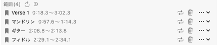

## 6. キー、BPM、コード進行

キー、BPM、コード進行は、音から推定した値です。間違うことがあります。

### 再生画面のコード進行

「再生」タブの下のほうに、「コード進行」のボタンと、推定したキー（「キー E」など）、カポ、8 小節のコード（入らないときは 4 小節ずつ 2 段）、「コードフォーム」の「現在」「次」が出ます。いま鳴っている小節が強調されます。表示は、移調とカポを反映します。カポは、「練習モード」の欄で、「自動」か 0〜12 を選べます。

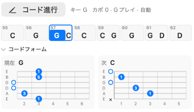

間違っているコードは、直せます。「コード進行」を押して、元のキーでコードを書き直します。「小節」方式では、1 小節に「G D7」のように 2 つまで書けます。空欄は、前のコードの続きです。BPM もここで設定できます。「アドバンスト」では、1 行に「開始時刻 コード」を書きます。手で直したコードは、自動の推定で上書きされません。

コードは、メジャー、マイナー、セブンスだけを見分けます。伴奏の薄い所、ソロの間、速いコードチェンジでは、間違いやすくなります。

### テンポ（BPM）

テンポは、「ノリ・チェック (試験的)」のタブに、「テンポ: 160 BPM」のように表示されます。実際の倍や半分で出ることがあります。

## 7. 自分の録音

自分の歌や演奏を、曲に合わせて録り、あとで同じ曲と一緒に聴けます。

1. ヘッドホンをつけます。スピーカーで鳴らすと、曲の音がマイクに入って、曲と合わなくなります。
2. 「分離を有効化」をオンにして、曲を流します。
3. 「録音」タブを開き、「自分の録音」の「マイク」を選びます。
4. 「ヘッドホンで聴いている」にチェックを入れます。
5. 「● 録音」を押します。終わったら「■ 録音を止める」を押します。
6. 同じ曲をもう一度流して、「一緒に再生」を押すと、曲に合わせて鳴ります。「音量」と「ずれ補正」で調整します。

保存するのは、マイクの音だけです。曲の音は保存しません。

ためて再生中と、速さを落としている間は、録音できません。初めて録音するときは、macOS がマイクの許可を確認します。

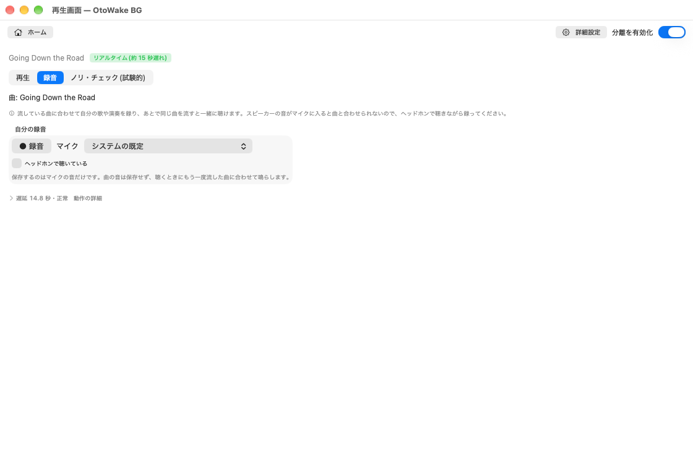

ファイルを開いているときは、「再生」タブの「録音を重ねる…」で、録った録音を曲に重ね、1 つの演奏として測れます。

## 8. タブ譜

ホームの見出しの右にある「タブ譜」を押すと、タブ譜の窓が開きます。

### 一覧と新しいタブ譜

- 左の一覧は、「ブック」、楽器、「お気に入りだけ」（星のボタン）、検索で絞り込めます。
- 左下の「新規」から、空のタブ譜（ギター、マンドリン、ベース、バンジョー、ドブロ）を作れます。
- 「ファイルを読み込む…」では、MusicXML、Power Tab、Guitar Pro、TablEdit のファイルと、タブ譜の画像や PDF を読み込めます。

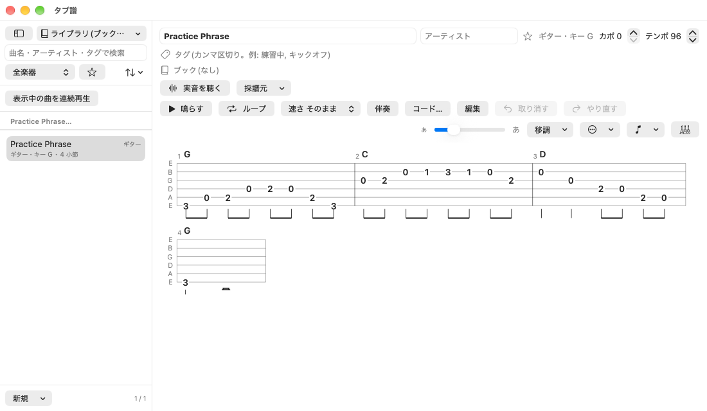

### 写真や PDF のタブ譜を読み取る

1. 「ファイルを読み込む…」で、タブ譜の画像か PDF を選びます。
2. アプリが、読み取れる所を読んで、下書きのタブ譜を作ります。リズムは、読めた所だけ読みます。
3. 全部の小節に「?」の印が付きます。「元の画像を並べる」で、元の画像を横に出して見比べ、直します。
4. 合っていた小節は、「小節」メニューの「「?」の印を消す(確かめた)」で印を消します。

線が薄い画像や、大きく斜めに撮った写真は、読めないことがあります。手書きの譜面は、まだ試していません。

近くの iPhone のカメラで撮るには、「新規」のメニューから「iPhone で撮る…」を選びます。同じ Apple Account の iPhone が近くにあり、Wi-Fi と Bluetooth がオンで、iPhone の「設定」の「一般」の「AirPlay と連係」の「連係カメラ」がオンになっている必要があります。最初の 1 回、macOS がカメラの許可を確認します。撮ったあと、「タブ譜にする」を押します。

### 見る、聴く

- 「鳴らす」で、楽器の音で再生します。「ループ」、「速さ」、「伴奏」も使えます。
- 右上の指板のボタンで、いまの小節の押さえを指板の図で見られます。弦をクリックすると、その音が鳴ります。
- 「採譜元」の「音源を関連付け…」で、元の音声ファイルかミュージックの曲を結ぶと、「実音を聴く」で、分けた実際の音と聴き比べられます。

### 編集する

1. 「編集」を押します。譜面の上に、編集のボタンが並びます。
2. 音を選び、数字を打つと、フレットが入ります。矢印で位置を動かし、delete で消します。H、P、S でハンマリング、プリング、スライド、T でタイ、X でミュート、N でハーモニクスです。
3. 「小節」メニューで、小節のコピー、貼り付け、拍子、繰り返しなどを変えます。
4. 「コード…」で、全小節のコード名を 1 つの文章で書き直せます。
5. 間違えたら、「取り消す」「やり直す」を使います。

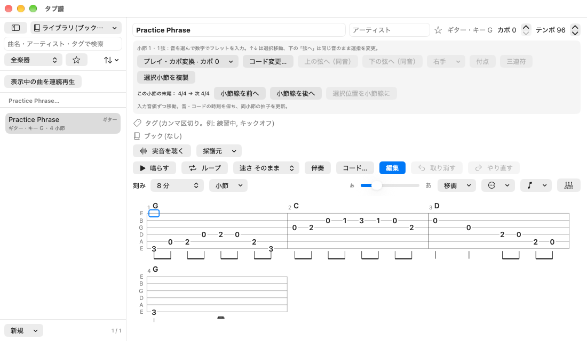

### 移調と書き出し

- 「移調」で、別のキーのタブ譜を、別のタブ譜として保存します。
- 「そのほか」（…のボタン）の「MusicXML を書き出す…」「Guitar Pro 5 で書き出す…」で、ほかのソフトに渡せます。

## 9. 試験的な機能

「試験的」と表示される機能です。使う前に、リリースノートの「留意事項」の「試験的な機能」を読んでください。

### ノリ・チェック（試験的）

再生画面の「ノリ・チェック (試験的)」のタブでは、楽器ごとの音が拍のどの位置で鳴っているか（ノリ）と、リズムのブレ、歌の音程（チェック）を測ります。

1. 「分離を有効化」をオンにして、曲を流します。
2. 「ノリ・チェック (試験的)」のタブを開きます。12 秒ほど聴いたあとに、表示が始まります。
3. 「ノリ」には、この曲のノリ（「はっきり後ノリ」など）と、テンポ、拍のゆれが出ます。「拍の中の位置」の図は、ベースの「ボン」からマンドリンの「チャック」、次の「ボン」までのあいだで、ベース、ギター、マンドリン、バンジョーが音を出している位置です。
4. 「チェック」には、リズムのブレと歌の音程が出ます。測れるまでは、「まだ測れていません」と表示されます。

数値は目安です。分離がうまくいかない曲では、数値も当てになりません。歌の音程は、8 音以上測れたときに表示されます。

「演奏の測定を保存する」をオンにすると、この画面を開いていないあいだも、曲ごとに数値を保存します（音声は保存しません）。30 秒以上測った曲は、「表示する曲」から見直せます。「履歴をすべて削除…」で消せます。

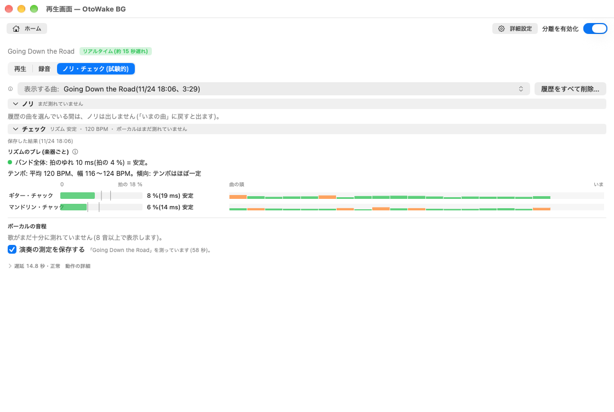

### AI 採譜（MCP）（試験的）

採譜は、あなたが用意した AI アシスタント（MCP に対応していて、自分の設定を変えられるもの）が行います。アプリの中では、自動で採譜しません。

**つなぎ方**

1. 再生画面の右上から、「詳細設定」を開きます。「一般」の「MCP 設定 (試験的)」があります。
2. 「MCP の登録を AI に頼む文をコピー」を押します。
3. コピーした文を、AI アシスタントのチャットに貼ります。AI アシスタントが、OtoWake BG の MCP サーバーを自分で登録します。登録される名前は「otowake-bg」です。
4. AI アプリの設定に自分で書き込む場合は、「設定(JSON)をコピー」を使います。
5. 同じ欄の「再生画面に「AI に採譜を頼む」ボタンを出す」をオンにします。最初はオフです。オンにするまで、再生画面に採譜のボタンは出ません。

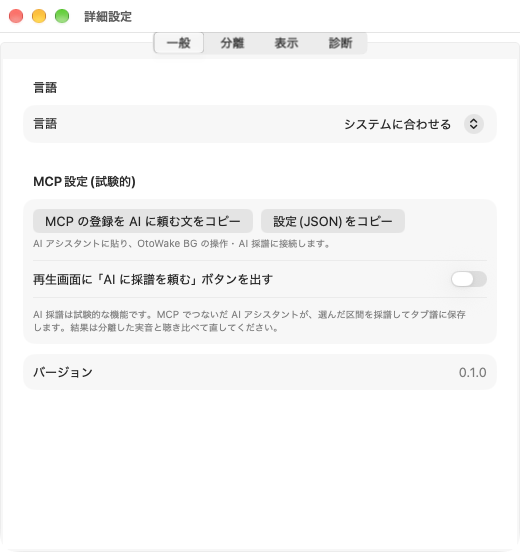

**採譜を頼む**

1. 採譜したい曲を流します。「範囲」の一覧に、ブレイクなどの範囲を出します。
2. 範囲の行の「AI に採譜を頼む」を押し、パートを選びます。依頼文がコピーされます。
3. 依頼文を、AI アシスタントのチャットに貼ります。
4. AI が採譜して保存すると、タブ譜の窓に入ります。

Mac の音で流した曲は、曲の終わりに、直近 5 分の分けた音をメモリに残すので、続けて頼めます。

AI は、拍、音名、音の候補などの数値を受け取ります。音の候補は、音声から簡易な方法で拾ったもので、あまり正確ではありません。AI の採譜には、間違いや、弾けない運指が多く含まれることがあります。必ず耳で確かめて、直してください。

音声そのものは、自動では送りません。ただし、選んだ区間の分離音は、この Mac の中に保存してあり、AI アシスタントが求めると、1 回に最大 30 秒ずつ渡されます。

## 10. 困ったとき

**音が取り込めない**
「システムオーディオの収録が許可されていません。」と出たら、「設定を開く」を押し、「画面収録とシステムオーディオ録音」で OtoWake BG を許可します。「アプリを指定」を使っているときは、そのアプリで曲を流しているか確かめて、「一覧を更新」を押します。

**歌が聞こえない**
新しい曲では、「ボーカル」が 0% から始まります。「パート別の調整」で、「ボーカル」のスライダーを上げます。

**音が途切れる**
重いアプリを閉じます。詳細設定の「分離」の「処理が追いつかないとき」にある「再生方法」を、「常にためる」にします。メモリの上限で取り込みが止まったときは、「分離を有効化」をオフにして、もう一度オンにします。

**「ブルーグラス」を選べない**
「分離モデルがありません」と出たときは、アプリを入れ直してください（モデルはアプリに入っています）。

**区間リピートで位置が戻らない**
ミュージックなどの操作の許可を求められたら、許可します。ブラウザの曲は動かせません。

**窓が見つからない**
メニューバーのアイコン、⌃⌥⇧O、Dock のアイコンで開きます。

**ファイル名の横に「(見つかりません)」と出る**
ファイルが移動しています。「開く…」で選び直します。DRM のある曲は、「Macの音」で流します。

**録音に曲が混ざる**
スピーカーの音がマイクに入っています。ヘッドホンを使ってください。

**エラーを報告したい**
エラー表示の「詳細をコピー」で、情報をコピーできます。感想や不具合の連絡先は、[リリースノート](release-notes.md)にあります。

## 付録：ショートカット

| 操作 | キー |
|---|---|
| 操作パネルを窓として開閉 | ⌃⌥⇧O |
| 分離のオン／オフ | ⌃⌥⇧K |
| キーを上げる／下げる | ⌃⌥⇧↑ ／ ⌃⌥⇧↓ |

ほかのアプリが同じショートカットを使っているときは、登録できないことがあります。その場合は、詳細設定の「表示」に出ます。
