# OtoWake BG 使い方（Windows 版）

この手引きは、OtoWake BG の Windows 版で、この版にある機能を使うための手順をまとめたものです。使う前に、[リリースノート](release-notes.md)の「留意事項」を読んでください。

画面の名前は「　」で囲んで書いています。画面の名前が違って見えるときは、アプリのバージョンの違いかもしれません。

## 1. インストールと最初の起動

### 必要なもの

- Windows 11（x64）
- DirectX 12 対応の GPU を推奨します。GPU がなくても CPU で動きますが、処理が間に合わないことがあります。
- 使うことを許された音声（音声ファイル、または PC で再生中の音）

### インストール

OtoWake BG は、セットアップのファイル（`OtoWakeBG-Setup-<バージョン>-win-x64.exe`）で届きます。セットアップの画面は、Windows の表示言語に合わせて日本語か英語で出ます。

1. ダウンロードした `OtoWakeBG-Setup-<バージョン>-win-x64.exe` をダブルクリックします。管理者の権限も、.NET の追加インストールも要りません。
2. デスクトップにショートカットを作るかどうかを選び、「次へ」「インストール」を押します。
3. 「完了」を押すと、OtoWake BG が起動します（起動しないときは、チェックを外してから「完了」を押します）。

セットアップには開発元の署名がないため、「Windows によって PC が保護されました」と出ることがあります。そのときは「詳細情報」を押し、「実行」を押します。

新しいバージョンのセットアップを開くと、入っている OtoWake BG が置き換わります。設定とデータはそのまま残ります。OtoWake BG が動いているときは、セットアップが終了を求めます。

OtoWake BG は、`%LOCALAPPDATA%\Programs\OtoWake BG` に入ります。スタートメニューには、「OtoWake BG」のフォルダーができます。分離のモデルは、アプリに入っています。

設定と保存したデータは、`%APPDATA%\OtoWake BG` と `%LOCALAPPDATA%\OtoWake BG` に保存されます。

### 起動

スタートメニューの「OtoWake BG」から起動します（実行ファイルの名前は `OtoWakeBG.exe` です）。窓の名前は、「ホーム — OtoWake BG」「再生画面 — OtoWake BG」のように、「OtoWake BG」で終わります。

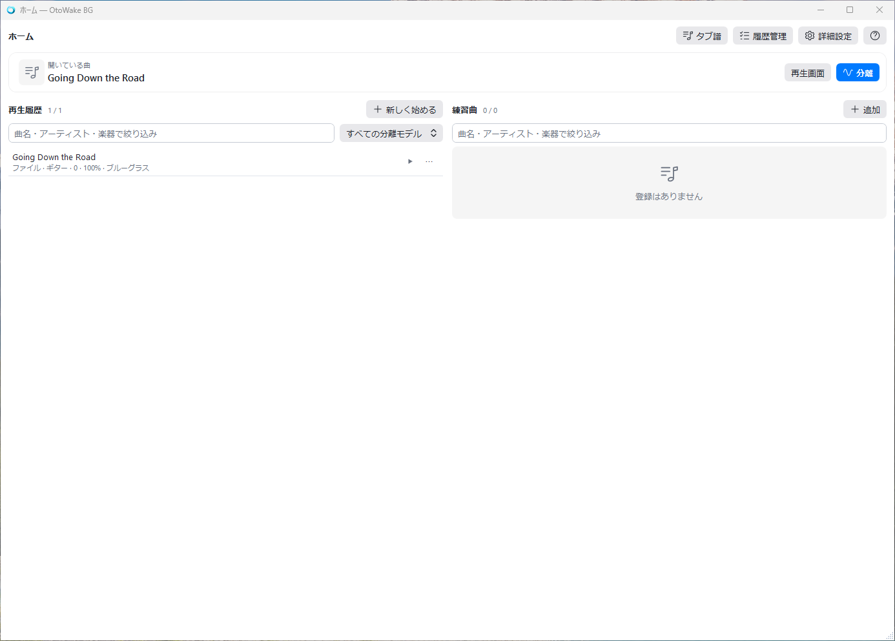

### アンインストール

スタートメニューの「OtoWake BG」フォルダーにある「OtoWake BG をアンインストールする」（英語でインストールしたときは「Uninstall OtoWake BG」）か、Windows の「設定」の「インストールされているアプリ」から削除します。設定と録音は、削除しても残ります。

### ウィンドウを閉じたとき

ウィンドウを閉じても、OtoWake BG は通知領域（時計の近く）で動き続けます。アイコンをクリックすると、ウィンドウが出ます。完全に終わらせるには、アイコンを右クリックして「終了」を選びます（音の出力先は、このとき元に戻ります）。

- Ctrl+Alt+Shift+O：ウィンドウを表示
- Ctrl+Alt+Shift+K：分離のオン／オフ

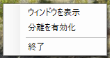

## 2. 音を入れる

### 再生画面の基本

ホームの「再生履歴」の「新しく始める」を押すと、再生画面が開きます。上の「分離を有効化」をオンにすると、分離が始まります。音が出るまで、数秒から十数秒以上かかります。GPU のない PC では、30 秒ほどかかることもあります。はじめて使うモデルは、さらに時間がかかることがあります。

上の行に、処理の方式（リアルタイムか、ためて再生）と、遅れが出ます。

分離のモデルが見つからないときは、そのことが表示され、中央の音を消す「かんたん分離(AI なし)」で鳴ります。その場合は、OtoWake BG を入れ直してください。

### 音声ファイルを使う

1. 「再生」タブの「再生元」で、「ファイル」を選びます。
2. 「ファイルを開く…」を押して、DRM（コピー防止）のない音声ファイルを選びます。ファイルは先頭から流れます。
3. ファイルを開くと、分離が自動で始まります（「分離を有効化」がオンになります）。

前に流したファイルは、ホームの「再生履歴」から選べます。「名前…」で、履歴に出る名前を変えられます（ファイルそのものの名前は変わりません）。

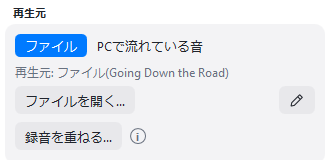

### PC で再生中の音を使う

1. 「再生元」で、「PCで流れている音」を選びます。
2. 「音を出しているアプリを自動で取り込む」にチェックが入っているときは、音を出しているアプリの音を、まとめて取り込みます。Windows の通知音は加工されず、そのまま鳴ります。
3. 1 つのアプリの音だけにしたいときは、チェックを外します。「取り込むアプリ・デバイス」に、音を出しているアプリが並びます。一覧に出ないときは「更新」を押して、アプリを選びます。
4. 曲を流して、「分離を有効化」をオンにします。

Windows の音量ミキサーを手で操作する必要はありません。

ブラウザの音も、同じように使えます。ただし、保護された音声や、アプリの音声の方式によっては、取り込めないことがあります。音が入らないときは、「入力が無音です」と表示されます。

「PCで流れている音」では、直近 2 分まで戻って聴けます。「ライブに戻る」を押すと、いまの音に戻ります。

### 出力を選ぶ

「出力」で、実際に聴くスピーカーかヘッドホンを選びます。一覧が古いときは「更新」を押します。

### 遅れについて

音を取り込んで分けるため、分けた音は元の音より遅れて聞こえます。目安は、6 秒に、処理時間の 2 倍と 0.75 秒を足した時間です。動画と一緒に使うと、映像より音が遅れます。「リアルタイム」は、遅れがゼロという意味ではありません。

ファイルを開いたときは、曲を 2 回分けて平均するため（詳細設定の「分離」タブの「ファイルは 2 回分けて平均する」）、さらに 6〜7 秒遅れます。この設定をオフにすると、短くなります。そのかわり、楽器の分かれ方が曲の区切り位置で揺れやすくなります。

## 3. パートの音量を変える

1. 「分け方」が「ブルーグラス」になっていることを確かめます。
2. 「パート別の調整」を開きます。パートごとに、チェックと音量のスライダーが並びます。
3. チェックを外すと、そのパートが消えます。スライダーで音量を変えます。
4. 「全部オン」「全部オフ」で、まとめて切り替えられます。

使い方の例です。

- 自分のパートを消して、その録音を伴奏にして弾く。
- 聴きたいパートだけを聴くには、「全部オフ」を押してから、聴きたいパートをオンにします。
- 聴き取りたい楽器を上げて、フレーズを耳で確かめる。

パートは、ボーカル、バンジョー、マンドリン、フィドル、ドブロ、ギター、ベース、ドラム、ピアノ、その他の 10 です。

音量やパートのオンオフは、操作してから音に出るまで、通常 1〜2 秒かかります。

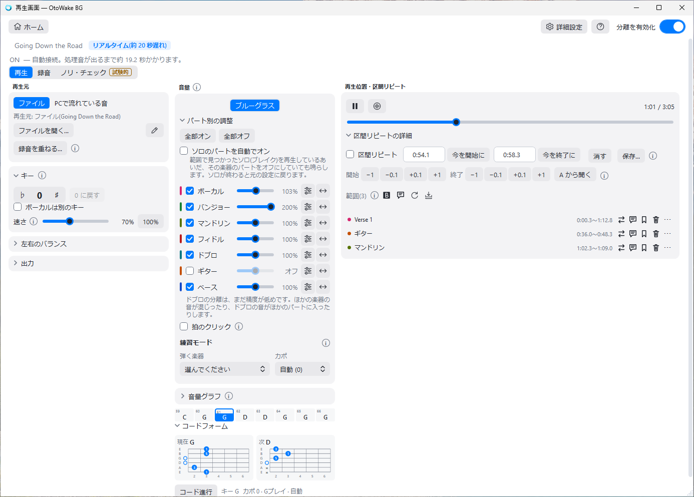

**ドブロについて**：ドブロの分離は、まだ精度が低くなっています。ほかの楽器の音が混ざったり、ドブロの音がほかのパートに入ったりします。

分けた音には、ほかのパートの音が少し混ざります。ボーカルを 0% にしても、声が薄く残ることがあります。

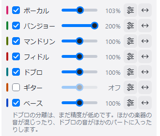

### 歌の間の楽器の音

歌っている間に、ギターやマンドリンの音がボーカルに入って小さくなることがあります。そのときは、詳細設定の「分離」タブの「歌の間の楽器の音」で、「ボーカルには配らない」を選ぶと、楽器が残りやすくなります。そのかわり、声の一部が楽器の側に残ります。変更は、次の処理の区切りから効きます。

### 練習の道具

- **練習モード**：「弾く楽器」を選ぶと、プリセットのボタンが出ます。押すと、パートの音量がまとめて設定されます。区間を選んでから押すと、その区間で練習できます。
- **音を伸ばす**：「再生」の欄の「止める」で曲を止めたあと、「音を伸ばす」を押すと、止めた瞬間の音を伸ばし続けます。音やコードを楽器で探すときに使います。
- **拍のクリック**：見つけた拍にクリックを重ねます。小節の頭は高く、大きく鳴ります。
- **音量グラフ**：オンのパートの音量を、線で表示します。
- 各パートの ♪ は音色（オクターブ、低・中・高の音量）、↔ はノリ（前後のタイミング）の調整です。

## 4. 速さとキーを変える

### 速さ

「速さ」で、曲をゆっくり再生します（50〜100%）。音の高さは変わりません。

- 音声ファイルは、そのまま遅くなります。
- プレイヤーの曲は、一時停止できるもの（メディア プレーヤー、Spotify、ブラウザなど）だけ遅くできます。止められない音は、もとの速さのままです。

### キー

「キー」の ♯ と ♭ のボタンで、曲の高さを半音ずつ変えます。「0 に戻す」で元に戻ります。

「ボーカルは別のキー」をオンにすると、歌と伴奏を別々に変えられます。詳細設定の「表示」タブで「キーをショートカットで変える」をオンにすると、Ctrl+Alt+Shift+↑ と Ctrl+Alt+Shift+↓ でも変えられます。

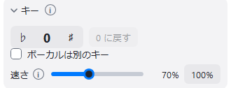

## 5. 区間リピートと範囲

### 区間を繰り返す

1. 「区間リピートの詳細」を開きます。
2. 曲を流して、始めたい位置で「今を開始に」、終わりたい位置で「今を終了に」を押します。時間を入力することもできます（0.5 秒以上）。
3. 「区間リピート」をオンにします。
4. −1、−0.1、+0.1、+1 秒のボタンで、端を細かく合わせます。
5. 「A から聞く」を押すと、区間の頭から繰り返して聴けます。
6. 「保存…」で名前を付けると、曲と一緒に残ります（「A パート」「バンジョーのブレイク」など）。
7. やめるときは、「消す」を押します。

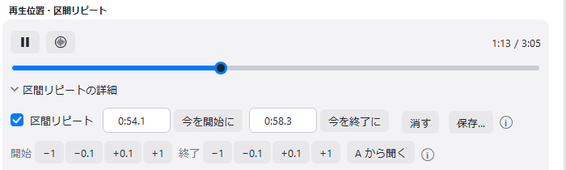

### 範囲の一覧

「範囲」の一覧には、次のものが並びます。

- 見つけたブレイク（ひとつのパートが前に出る、4 秒以上の区間）
- 歌の Verse とコーラスの下書き
- 「保存…」で名前を付けた区間

名前を押すと、そこへ移動します。行にマウスを重ねると、操作のアイコンが出ます。「繰り返す」「名前を変える」「上と結合」「下と結合」「開始を広げる」「終了を広げる」と、保存、「一覧から外す」ができます。範囲を見つけるのは、「ブルーグラス」のときだけです。

音声ファイルでは、分離をオンにして曲を流すと、一覧が埋まっていきます。「PCで流れている音」では、「自動範囲分析」をオンにします。「自動保存」をオンにすると、曲の終わりに範囲を曲と一緒に保存して、プレイヤーを次の曲へ進めます。

「範囲をもう一度検出」で、検出をやり直します。保存した範囲は残ります。「見つけた範囲をすべて保存」で、まとめて保存できます。

見つけた範囲は下書きです。名前や境目が違うことがあります。聴いて確かめてください。

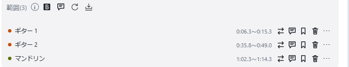

## 6. コード進行とテンポ（BPM）

コード進行とテンポは、音から推定した値です。間違うことがあります。

### 再生画面のコード進行

「分け方」が「ブルーグラス」のとき、再生画面にコード進行（8 小節を 1 行、狭いときは 4 小節ずつ 2 段）と、「コードフォーム」の「現在」「次」が出ます。ブルーグラスでは、推定したコード進行を曲ごとに保存します。

間違っているコードは、直せます。「コード進行」を押して、元のキーのコードを小節ごとに入れます。「G D7」のように、空白で 2 つまで書けます。空欄は、前のコードの続きです。手で直したコードは、自動の推定で上書きされません。ギター、バンジョー、ドブロは、練習モードの「カポ」で、「自動」か 0〜12 を選べます。

コードは、メジャー、マイナー、セブンスだけを見分けます。伴奏の薄い所、ソロの間、速いコードチェンジでは、間違いやすくなります。

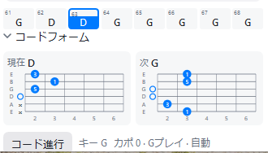

### テンポ（BPM）

テンポは、「ノリ・チェック」のタブ（試験的）に、「テンポ：平均 ○ BPM」と出ます。実際の倍や半分で出ることがあります。

## 7. 自分の録音

自分の歌や演奏を、曲に合わせて録り、あとで同じ曲と一緒に聴けます。

1. ヘッドホンをつけます。スピーカーで鳴らすと、曲の音がマイクに入って、録音に混ざります。
2. 「分離を有効化」をオンにして、曲を流します。
3. 「録音」タブを開き、「マイク」を選びます。マイクが使えないときは、「マイクの設定を開く」を押して、Windows の設定で、デスクトップアプリにマイクの使用を許可します。
4. 「ヘッドホンで聴いている」にチェックを入れます。
5. 「● 録音」を押します。終わったら「■ 録音を止める」を押します。
6. 録音は一覧に追加されます。同じ曲をもう一度流して、「一緒に再生」を押すと、曲に合わせて鳴ります。

録音ごとに、音量（0〜200%）と、タイミングのずれ（10 ms 単位）を調整できます。Bluetooth のヘッドホンは遅れが大きいため、合わないときは、有線のヘッドホンやマイクを試してください。

保存するのは、マイクの音だけです。曲の音は保存しません。

ためて再生中、区間リピート中、遅く再生している間は、録音できません。

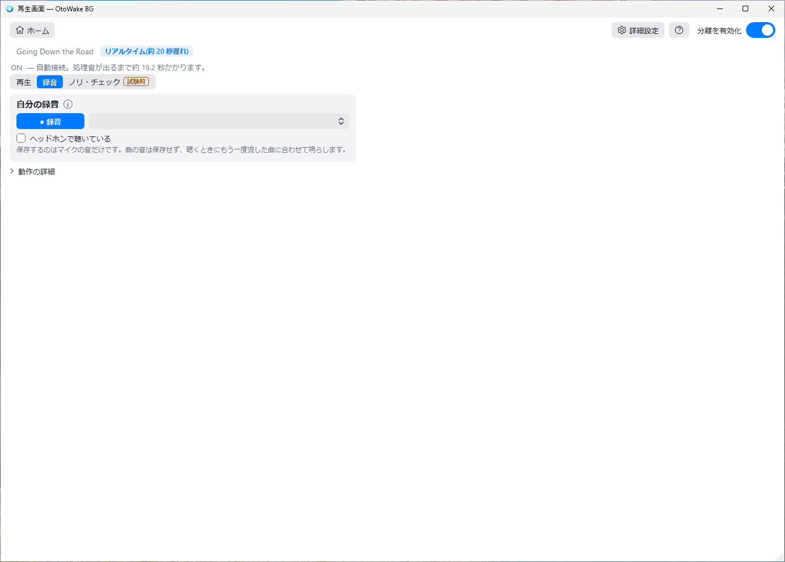

ファイルを開いているときは、「録音を重ねる…」で、録った録音を曲に重ね、1 つの演奏として測れます。

## 8. タブ譜

ホームの見出しの右にある「タブ譜」を押すと、タブ譜の窓が開きます。

### 一覧と新しいタブ譜

- 一覧は、曲名、アーティスト、タグ、キーで検索できます。楽器、お気に入り、タグでも絞り込めます。「ブック」でまとめられます。
- 空のタブ譜を作る、「複製」する、「MusicXML・Power Tab・Guitar Pro・TablEdit を読み込む…」で読み込むことができます。
- 一覧で Ctrl や Shift を押しながら複数を選ぶと、まとめて削除できます。

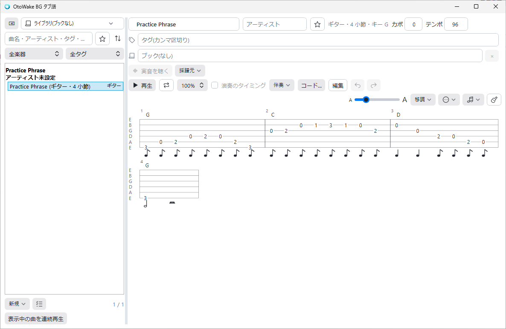

### 紙のタブ譜を読み取る

1. 「カメラで取り込む」を押します。
2. カメラに、タブ譜の紙を向けて、撮ります。
3. アプリが、読み取れる所を読んで、下書きのタブ譜を作ります。
4. 全部の小節に「?」の印が付きます。元の写真と見比べて、直してください。

紙の読み取りには、Windows に英語の文字認識が入っている必要があります。入っていないときは、「文字認識を使えません。Windows に英語の文字認識を追加してください。」と出ます。

画像ファイルや PDF のタブ譜の読み取りは、「試験的」の AI 採譜（MCP）のとおり、あなたの AI アシスタントに頼みます（「9. 試験的な機能」を見てください）。

### 見る、聴く

- 「カウントイン(2 小節)」「小節の範囲をループ」「速さ」「ベース伴奏」「ギター伴奏」で、練習できます。
- 「指板」で、いまの小節の押さえを指板の図で見られます。弦をクリックすると、その音が鳴ります。
- 「音源を関連付け…」で元の録音と結ぶと、「曲にTABを重ねて鳴らす」も使えます。

### 編集する

1. 譜面をクリックしてカーソルを置き、数字を打つと、フレットが入ります（2 桁も入力できます）。矢印で移動し、Delete で消します。
2. Shift を押しながらクリックすると、小節の範囲を選べます。
3. H、P、S、N、X、T で、ハンマリング、プリング、スライド、ハーモニクス、ミュート、タイを付けます。[ と ] で音の長さを変えます。
4. 「保存 Ctrl+S」で保存します。元に戻す、やり直しも使えます。

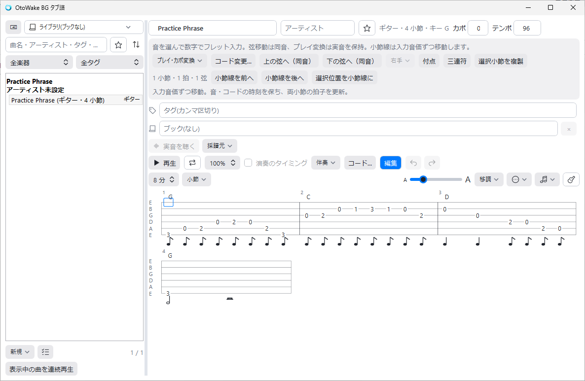

### 移調と書き出し

- 「移調して保存」で、別のキーのタブ譜を、別のタブ譜として保存します。「運指を保つ」を選べます。
- 「MusicXML を保存…」「Guitar Pro 5 を保存…」「テキストを保存…」で、ほかのソフトに渡せます。

## 9. 試験的な機能

「試験的」と表示される機能です。使う前に、リリースノートの「留意事項」の「試験的な機能」を読んでください。

### ノリ・チェック（試験的）

「ノリ・チェック」のタブ（「試験的」のバッジが付いています）では、楽器ごとの音が拍のどの位置で鳴っているか（ノリ）と、リズムのブレ、ボーカルの音程（チェック）を測ります。

1. 「分け方」を「ブルーグラス」にして、分離を有効化し、曲を流します。
2. 「ノリ・チェック」のタブを開きます。
3. 「ノリ」の図は、ベースの「ボン」からマンドリンの「チャック」、次の「ボン」までのあいだで、各楽器が音を出している位置です。
4. 「チェック」では、リズムのブレと、ボーカルの音程を見ます。

数値は目安です。分離がうまくいかない曲では、数値も当てになりません。歌声は、8 音以上測れたときに、グラフに表示されます。

曲の測定が 30 秒以上たまると、履歴に残ります。「表示する曲」で、「いまの曲」か、履歴の曲を選べます。「演奏の測定を保存する」をオンにすると、このタブを開いていないあいだも、曲ごとに数値を保存します（音声は保存しません）。「履歴をすべて削除…」で消せます。

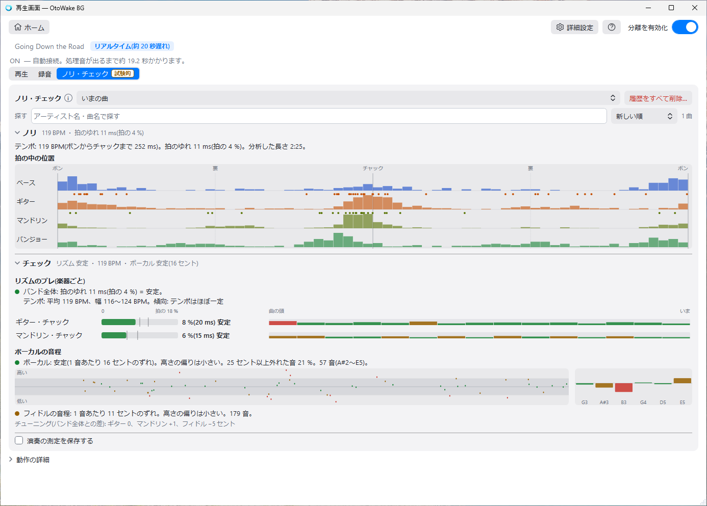

### AI 採譜（MCP）（試験的）

採譜は、あなたが用意した AI アシスタント（MCP に対応していて、自分の設定を変えられるもの）が行います。アプリの中では、自動で採譜しません。

**つなぎ方**

1. 「詳細設定」を開き、「診断」タブの下のほうにある「AI アシスタントによる採譜(MCP)」（試験的）を開きます。
2. 「MCP の登録を AI に頼む文をコピー」を押します。
3. コピーした文を、AI アシスタントのチャットに貼ります。AI アシスタントが、OtoWake BG の MCP サーバーを自分で登録します。登録される名前は「otowake-bg」です。
4. AI アプリの設定に自分で書き込む場合は、「設定(JSON)をコピー」を使います。

OtoWake BG を更新したときは、つないでいる AI アプリも再起動してください。

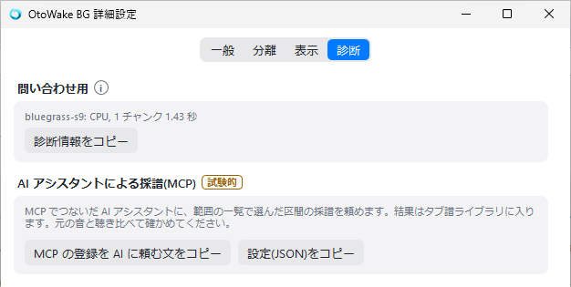

**採譜を頼む**

1. 採譜したい曲を流します。「範囲」の一覧に、ブレイクなどの範囲を出します。
2. 範囲の行の「AI に採譜を頼む」を押し、パートを選びます。依頼文がコピーされます。
3. 依頼文を、AI アシスタントのチャットに貼ります。
4. OtoWake BG を起動したまま待ちます。AI が採譜して保存すると、タブ譜の窓に入ります。

「PCで流れている音」では、「自動範囲分析」をオンにしておくと、分けた音を直近 5 分、メモリに残します。流し終えた範囲も、続けて頼めます。

AI は、拍、音名、音の候補などの数値を受け取ります。音の候補は、音声から簡易な方法で拾ったもので、あまり正確ではありません。AI の採譜には、間違いや、弾けない運指が多く含まれることがあります。

音声そのものは、自動では送りません。ただし、選んだ区間の分離音は、この PC の中に保存してあり、AI アシスタントが求めると、1 回に最大 30 秒ずつ渡されます。AI の採譜は、必ず耳で確かめてください。

**画像や PDF のタブ譜を読み取る**

AI アシスタントに、タブ譜の画像や PDF のファイルを渡して、読み取りを頼めます。AI が下書きを作り、段ごとの画像と見比べて直します。読み取りには、Windows に英語の文字認識が必要です。下書きの小節には「?」の印が付き、AI が確かめた小節から印が消えます。

## 10. 困ったとき

**ONにしても音が聞こえない**
「出力」が、実際に使うスピーカーかヘッドホンになっているか確かめます。「更新」で一覧を読み直します。音源のアプリで曲が再生中か確かめます。ファイルのときは、DRM のない音声ファイルを試します。モデルの読み込みや、初回の速さの測定が終わるまで待ちます。

**PC の音が入らない**
「音を出しているアプリを自動で取り込む」をオンにして試します。アプリを選ぶときは、「更新」を押して、選び直します。保護された音声や、アプリの音声の方式によっては、取り込めません。Windows の音量ミキサー、再生デバイス、アプリのミュートも確かめます。

**音が途切れる、遅れる**
処理が PC の速さに追いついていない可能性があります。「ためて再生にする」を押すか、詳細設定の「分離」タブの「再生方法」を「自動」にします（自動では、負荷が高いときに、音をためてから再生します）。「リアルタイム」に固定すると、遅れは最小ですが、処理能力が足りないと途切れます。GPU の設定（「GPU を使う(DirectML)」）のオンオフも試します。

**「AI 処理が失敗しています」と出る**
「CPU に切り替える」を押すか、OtoWake BG を再起動します。

**特定の楽器が聞こえない**
「分け方」が「ブルーグラス」か、その楽器のチェックがオンか、スライダーが 0 になっていないかを確かめます。完全に分かれずに音が残ることもあります。

**録音に曲が混ざる**
スピーカーの音がマイクに入っています。ヘッドホンを使い、録音の前に、マイクのレベルを確かめます。

**録音できない**
「マイクの設定を開く」で、デスクトップアプリのマイクを許可します。選んだマイクも確かめます。

**ウィンドウが見つからない**
通知領域のアイコンをクリックするか、Ctrl+Alt+Shift+O を押します。

**問い合わせたい**
詳細設定の「診断」タブの「診断情報をコピー」で、設定、機器名、モデルの状態、最近のログをコピーできます。音声や曲名は含まれませんが、ファイルの場所に、Windows のユーザー名が含まれることがあります。送る前に内容を確かめてください。感想や不具合の連絡先は、[リリースノート](release-notes.md)にあります。

## 付録：ショートカット

| 操作 | キー |
|---|---|
| ウィンドウを表示 | Ctrl+Alt+Shift+O |
| 分離のオン／オフ | Ctrl+Alt+Shift+K |
| キーを上げる／下げる | Ctrl+Alt+Shift+↑ ／ Ctrl+Alt+Shift+↓（詳細設定の「表示」タブで「キーをショートカットで変える」をオンにしたとき） |
| タブ譜を保存 | Ctrl+S |

ほかのアプリが同じショートカットを使っているときは、登録できないことがあります。その場合は、起動時の状態の行と、詳細設定に表示されます。
